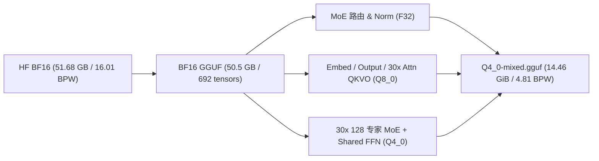

为了让 `DiffusionGemma-26B-A4B-it` 的 MoE 专家矩阵乘（`MUL_MAT_ID`）真正具备在 Qualcomm Hexagon NPU（`HTP0`）上运行的基础，必须使用 `ggml-hexagon` 原生支持的量化格式。

检查 [ggml-hexagon.cpp](https://github.com/ggml-org/llama.cpp) 可知，HTP 后端原生支持的量化类型为 **`Q4_0`、`Q8_0`、`IQ4_NL`、`F16`、`BF16`**，而常见的 `Q4_K_M` / `Q6_K` 均不在列。直接对 `Q4_K_M` 二次量化会造成严重的精度叠加损失，因此必须从 **BF16 原权重** 出发。

---

## 1. 为什么不能无脑全 `Q4_0`？——扩散 LLM 与 MoE 的精度敏感度

在确定量化策略前，我们梳理了近年离散扩散语言模型（dLLM）与 MoE 量化研究的核心结论：

### A. 离散扩散模型（dLLM）的误差累积效应
根据 *DLLMQuant* 与 *QDLM ("Quantization Meets dLLMs")* 等研究：
- **多步迭代误差放大**：不同于自回归模型每步只预测一个 token，离散扩散模型通过多轮去噪/去掩码（unmasking）逐步收敛。早期步骤中微小的 logits 偏移会导致错误的 token 被提前锁定，并在后续步骤中级联放大。
- **动态 Mask 比例与激活异常值**：不同时间步的 masked / unmasked token 比例变化剧烈，叠加注意力/FFN 通道中的激活异常值（outliers），使得均匀低比特量化对熵界采样（entropy-bound）的稳定性冲击更大。

### B. MoE 架构的分层敏感度
*Expert-Aware Quantization*、*GEMQ* 等论文指出，128 专家 MoE 各模块对低比特压缩的敏感度差异极大：
1. **门控路由（`ffn_gate_inp`）**：极度敏感。极小的权重扰动就会改变 Top-8/128 专家的路由选择。
2. **注意力投影（`attn_q/k/v/output`）与输出头（`output.weight`）**：直接决定全局上下文表征与最终去噪熵分布。
3. **专家 FFN（`ffn_gate_up_exps` / `ffn_down_exps`）**：占总参数量的 80%–90%，其中冷门/长尾专家与 `down_proj` 通道更容易受异常值影响。

---

## 2. 本机可落地的 Hexagon 原生混合精度方案

本机物理内存为 **31.6 GB**，而 BF16 GGUF 模型体积达 **48,184.40 MiB（50.5 GB）**。若在本机运行 `llama-imatrix` 校准 Pass 会触发严重内存颠簸（在免费 Colab T4 16 GB VRAM 下同样无法直接加载 50 GB BF16 权重）。

幸运的是，`llama-quantize` 支持在不运行 `imatrix` 的前提下，**按张量精确指定 Hexagon 原生混合精度**：

```text
--output-tensor-type Q8_0
--token-embedding-type Q8_0
--tensor-type "attn_q\.weight=q8_0"
--tensor-type "attn_k\.weight=q8_0"
--tensor-type "attn_v\.weight=q8_0"
--tensor-type "attn_output\.weight=q8_0"
Q4_0
```

各部分最终落盘精度如下（全部为 `ggml-hexagon` 原生支持类型）：
- **MoE 路由权重 (`ffn_gate_inp.weight`) & Norm / Scale**：保持 **`F32`**
- **词嵌入、输出头、全部 30 层 Attention Q/K/V/O**：**`Q8_0`**（`Llama-3-8B` 基准仅 `+0.0026 ppl`，几乎无损）
- **128 专家 MoE (`ffn_*_exps`) 与共享 FFN**：**`Q4_0`**（Hexagon HTP 原生平铺/分块格式）



| 指标 | BF16 GGUF | Mixed `Q4_0` + `Q8_0` GGUF |
| :--- | :--- | :--- |
| 文件体积 | `48,184.40 MiB` (`50.5 GB`) | **`14,464.82 MiB` (`14.1 GiB`)** |
| 平均每权重比特数 | `16.01 BPW` | **`4.81 BPW`** |
| 张量数量 | `692` | `692` |

---

## 3. Windows 11 ARM64 下载、转换与量化流水线

1. **直连高速下载（无代理 / 无 TAP）**：
   - 由于 `modelscope-hub` 依赖的 `cryptography==50.0.2` 在 `win_arm64` 上缺少预编译 wheel，我们编写了基于 `requests`（`trust_env=False` + 4 线程并发 + `Range` 断点续传）的轻量脚本直连 ModelScope API 下载 `google/diffusiongemma-26B-A4B-it` 全套 23 个文件（`51.68 GB`）。
   - 全程平均聚合速度约 **42.2 MB/s**，耗时 `1224.5s` 完成校验。
2. **原生 ARM64 PyTorch 转换**：
   - 使用 PyTorch 官方 CPU 源（`https://download.pytorch.org/whl/cpu`）在 Python 3.13.9 (`win_arm64`) 环境中直接安装原生 `torch==2.15.0+cpu`。
   - 运行 `convert_hf_to_gguf.py --outtype bf16`，约 `250s`（~201 MB/s）导出 `50.5 GB` BF16 GGUF。
3. **流式混合精度量化**：
   - 使用 `build-cpu\bin\llama-quantize.exe` 执行混合 `Q4_0 + Q8_0` 量化，耗时 **`95.14s`** 生成 `diffusiongemma-26B-A4B-it-Q4_0-mixed.gguf`。

量化完成后，我们立即将其送入 `HTP0` 进行全量 NPU 卸载测试——并由此揭开了两个深藏在 FastRPC 与 HTP 固件中的底层限制（见下一篇根因分析）。
