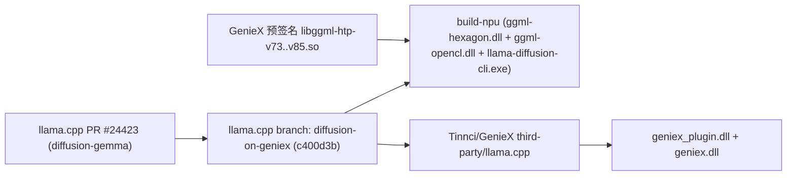

在 **Snapdragon X Elite (Windows 11 ARM64)** 上用 [qualcomm/GenieX](https://github.com/qualcomm/GenieX) 推理 `google/diffusiongemma-26B-A4B-it` 时，官方主线版本无法直接运行该模型。原因不在硬件算力，而在于 **架构支持与推理范式差异**。

本文记录从原因排查、工具链配置、代码移植到首次在 `HTP0` NPU 上跑通 `DiffusionGemma-26B-A4B-it` 的完整过程。

---

## 1. 为什么原版 GenieX 不支持 DiffusionGemma？

`DiffusionGemma-26B-A4B-it` 是基于 **Gemma 4 MoE（25.2B 总参数、128 专家每次激活 8 个、约 3.8B 激活参数）** 的**离散块扩散语言模型（Block Diffusion LLM）**，与常规自回归（AR）模型有三点根本区别：

1. **GGUF 架构与非因果注意力**：模型架构为 `diffusion-gemma`（`DiffusionGemmaForBlockDiffusion`），使用双向/块级注意力（`attention.causal = false`）与 256-token 扩散画布（`diffusion.canvas_length = 256`）。
2. **熵界早停（Entropy-Bound）迭代去噪循环**：推理不是逐 token 自回归 `llama_decode`，而是对整块 mask token 进行多步并行去噪采样（`diffusion_generate_entropy_bound`）。
3. **上游代码未合入**：相关模型加载与扩散调度器位于 `llama.cpp` PR `#24423`，GenieX 主线尚未同步该分支。

---

## 2. Windows 11 ARM64 NPU 编译工具链配置

为了从源码独立编译支持 Adreno OpenCL 与 Hexagon HTP NPU 的 `llama.cpp` 与 `GenieX`，在本机配置了以下原生工具链：

- **Adreno OpenCL SDK**: `C:\Qualcomm\OpenCL_SDK\2.3.2`（`adreno-opencl-sdk-v2.3.2-arm64-wos`）
- **Qualcomm Hexagon SDK**: `C:\Qualcomm\Hexagon_SDK\6.7.0.0`（内含 `HEXAGON_Tools\21.0.04`）
- **LLVM ARM64**: `LLVM 23.1.5`（`C:\Program Files\LLVM\bin`）
- **Visual Studio 生成工具 2022** + Ninja + CMake

> **Windows 11 ARM64 签名约束**：生产环境下的 Qualcomm FastRPC CDSP 加载器要求 `libggml-htp-v73.so` 具备合法签名（`libggml-htp.cat`）。因此在测试自研 `ggml-hexagon.dll` 时，需将主机侧重新编译的 `ggml-hexagon.dll` 与已签名的 `libggml-htp*.so` 搭配放入 `bin-signed-test` 目录。

---

## 3. 移植 PR #24423 到 `Tinnci/GenieX`

在 `C:\Users\shiso\dev\llama.cpp` 基于基线 `93cf736a8` 合入 PR `#24423`（剔除 CUDA 专属改动，形成分支 `diffusion-on-geniex`，commit `c400d3b`）后，将其作为 `Tinnci/GenieX` 的 `third-party/llama.cpp` 并修改插件层：

1. **`sdk/plugins/llama_cpp/src/CMakeLists.txt`**：链接 `diffusion.cpp` 静态库。
2. **`sdk/plugins/llama_cpp/src/llm.cpp`**：
   - 识别 `diffusion-gemma` 架构并自动开启 NPU 侧 `.*_exps` CPU 回退保护；
   - 将扩散推理所需的最小上下文与批处理上限调整为 `n_ctx >= 4096`、`n_batch >= 2304`、`n_ubatch >= 2304`、`n_outputs_max = 0`；
   - 接入 `diffusion_generate_entropy_bound` 迭代去噪循环。

编译并打包至 `test-cli` 后，执行 `geniex.exe infer "local/diffusiongemma-26B-A4B-it:Q4_K_M" --compute npu` 成功返回退出码 `0`。

---

## 4. `Q4_K_M` 基线实测与瓶颈

使用 `llama-diffusion-cli.exe` 在 `HTP0` 上对社区 `Q4_K_M` 量化版进行测试：

| 配置 | MoE 专家所在设备 | 注意力 / Dense 层设备 | 每步耗时 (`s/step`) |
| :--- | :--- | :--- | :--- |
| `-dev HTP0 -ngl 99 --n-cpu-moe 30 --diffusion-kv-cache on` | 30 层全 CPU | 30 层全 `HTP0` | `8.68 s/step` |
| `-dev HTP0 -ngl 99 --n-cpu-moe 25 --diffusion-kv-cache on` | 25 层 CPU / 5 层尝试 NPU | 30 层全 `HTP0` | `7.91 s/step` |

虽然模型已经能稳定运行，但从 `ggml-hexagon` 的算子支持表可以看出，**`Q4_K_M` 并非 Hexagon HTP 的原生格式**：128 专家 MoE 矩阵乘 `MUL_MAT_ID` 在 `Q4_K_M` 下无法由 HTP 原生执行，绝大多数计算仍停留在 CPU，并伴随着频繁的 CPU↔NPU 数据往返。

这也是我们决定下载 BF16 原始权重并转向 **`Q4_0` 混合精度量化** 的直接原因（见下一篇文章）。
