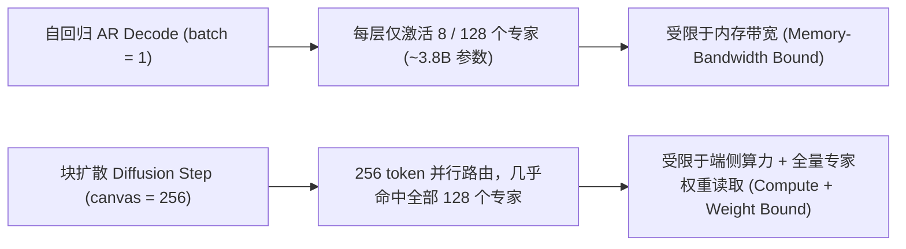
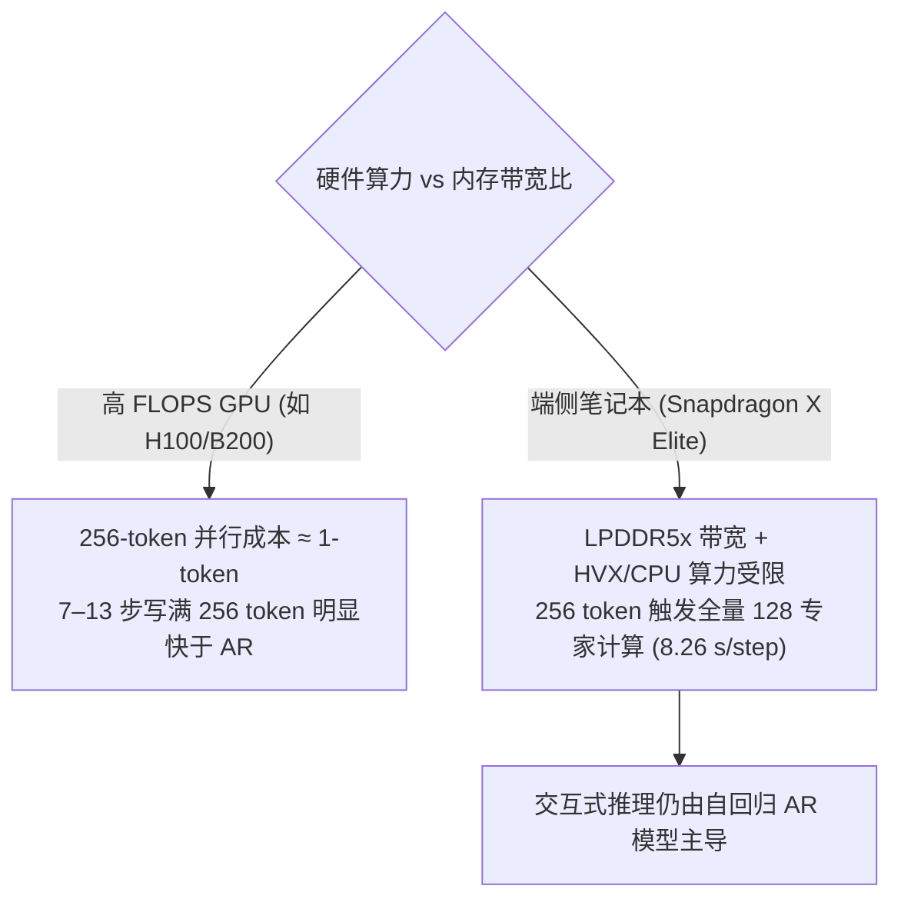

在跑通 `DiffusionGemma-26B-A4B-it`（Mixed `Q4_0 + Q8_0`）并把 `HTP0` 推理稳定在 `8.26 s/step` 后，一个很自然的问题是：**号称“多 token 并行去噪”的离散扩散模型，目前在端侧设备上比传统自回归（Autoregressive, AR）模型更快吗？**

结合我们在 **Snapdragon X Elite (Windows 11 ARM64)** 上的实测，答案是：**在当前端侧 NPU/CPU 硬件上，不仅不快，反而明显更慢。**

---

## 1. 实测数据：画布吞吐量 vs 真实交互延迟

在优化后的 `--n-cpu-moe 20` 配置下，两次典型测试的实测结果如下：

| 测试提示词 | 收敛步数（Entropy-Bound） | 每步耗时 | 总耗时 | CLI 报告吞吐（含 256 画布槽位） | 实际有效回复体验 |
| :--- | :--- | :--- | :--- | :--- | :--- |
| `"Hi"` | `7` 步（上限 48 步） | `8.26 s/step` | **`57.83 s`** | `4.4 tok/s`（步内并行 `31 tok/s`） | 仅 ~7 个有效输出 token |
| `"Explain how photosynthesis works in two sentences."` | `13` 步（上限 48 步） | `8.35 s/step` | **`108.61 s`** | `2.4 tok/s`（步内并行 `31 tok/s`） | 两句话科普回答 |

可以看到，虽然 Entropy-Bound 早停把步数从 `48` 步压缩到了 `7–13` 步，但因为**单步耗时高达 `8.26 s`**，哪怕只是回答一句 `"Hello! How can I help you today?"` 也需要等待近 **1 分钟**。

---

## 2. 为什么“并行扩散”在端侧 MoE 上反而变慢了？

### 原因 1：256-token 画布打破了 MoE 的“稀疏激活”红利
- **自回归模型（`batch = 1`）**：每生成一个 token，MoE 每层只读取并计算 **8 / 128** 个专家（约 `3.8B` 激活参数），瓶颈几乎完全在于 LPDDR5x 内存带宽。
- **块扩散模型（`canvas = 256`）**：每一步去噪都要对整块 **256 个 token**（含大量 `[MASK]`）做前向计算。256 个 token 分散路由后，**每一层几乎会命中全部 128 个专家**——原本用来省算力的稀疏 MoE，在端侧每步都退化成了接近 **26B 全量权重读取 + 重计算**（`~8.3 s/step`）。

### 原因 2：端侧算力与 IOVA/固件限制
- **HMX 受限与 HVX/CPU 回退**：正如我们在 [根因分析文章](/posts/ggml-hexagon-0x00000072-0x00000200-root-cause) 中定位的，签名版 `v73` 固件无法在 HMX 上稳定执行 `MUL_MAT_ID`（触发 `0x00000072`），导致 128 专家矩阵乘只能运行在 HVX 或 ARM64 CPU 上；同时 `domain_id 3` 的 `8–10 GB` IOVA 上限（`0x00000200`）也阻止了 14.46 GiB 模型全量常驻 `HTP0`。

### 原因 3：短回复下的“画布填充浪费”
- `llama-diffusion-cli` 统计的 `2.4–4.4 tok/s` 是按整块 `256` 个画布槽位计算的。对于十几到几十个 token 的日常对话，大部分槽位最终收敛为 `<pad>` / EOS，真正有用的输出 token 延迟与 AR 相比毫无优势。

---

## 3. DiffusionGemma 究竟在什么场景下才有速度优势？

离散块扩散并不是“慢”，而是**它把原本受内存带宽限制的 AR 串行解码，转换成了计算密集型的并行前向**：

1. **高算力数据中心 GPU（如 H100 / B200）**：
   - 当硬件 Tensor Core FLOPS 极高时，一次处理 `256` 个 token 的延迟与处理 `1` 个 token（纯受显存带宽限制）非常接近。此时用 `7–13` 步完成 `256` 个有效 token，等效吞吐量可以达到传统 AR 解码的数倍。
2. **长文本/满画布输出**：
   - 当生成任务（如长代码块、结构化文档续写）能够填满大部分 256-token 画布时，并行去噪的“每步有效 token 数”才会真正体现出来。

**结论**：在当前的 **Snapdragon X Elite** 等端侧笔记本平台上，受限于 LPDDR5x 带宽、Hexagon IOVA 窗口以及 HVX/CPU 对大 batch MoE 的计算吞吐，**同级别自回归模型依然是交互式本地推理的绝对主力**；DiffusionGemma 更适合高算力 GPU 服务端，或作为端侧离散扩散与 NPU 算子边界的工程研究样本。
