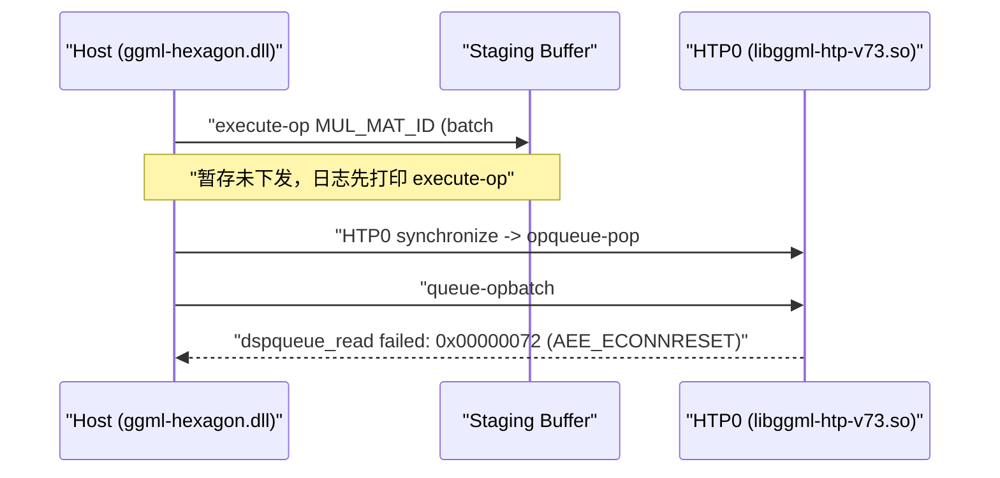
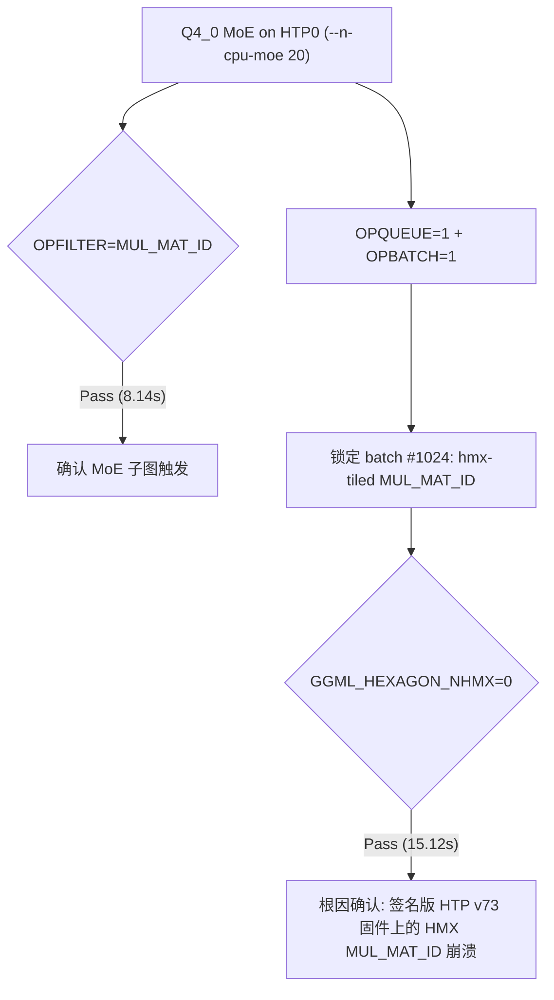
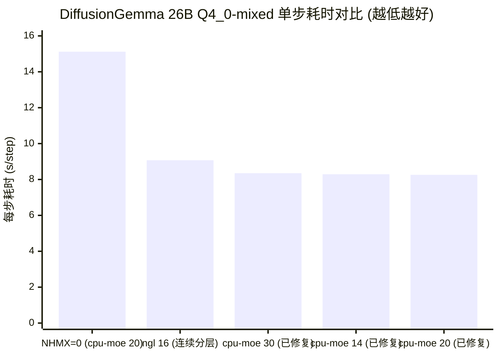

将 `DiffusionGemma-26B-A4B-it-Q4_0-mixed.gguf`（`14.46 GiB`）直接以 `-dev HTP0 -ngl 99` 全量卸载到 Snapdragon X Elite `HTP0` NPU 时，我们连续遭遇了两个错误：`0x00000200` 与 `0x00000072`。

本文完整还原我们如何通过对比实验与同步算子追踪（`OPQUEUE=1` + `OPBATCH=1` + `VERBOSE=1`）逐层剥离假象、锁定最终根因并完成修复。

---

## 1. 第一关：`0x00000200` — FastRPC `domain_id 3` IOVA 空间上限

全量卸载运行时，日志在映射计算缓冲区阶段报错退出：

```text
E ggml-hex: HTP0 buffer mapping failed : domain_id 3 size 953102336 fd 160 error 0x00000200
E ggml-hex: HTP0 possibly out of IOVA space, try --no-host
```

### 排除干扰项
我们依次验证了以下假设，均仍触发 `0x00000200`：
- 添加 `--no-host` CLI 参数；
- 设置 `GGML_HEXAGON_HOSTBUF=0`；
- 启用多会话 `GGML_HEXAGON_DEVICES="HTP0,HTP1"`（双会话在 Windows CDSP 上仍共享 `domain_id 3` IOVA 地址池）；
- 将 `--n-cpu-moe` 设为 `2` 或 `8`（NPU 权重仍约 `11.2–13.6 GB` + `968 MB` 计算缓冲区）。

当把 `--n-cpu-moe` 调整为 `20`（NPU 侧约 `6.5 GB` 权重）时，`fastrpc_mmap` 顺利通过。这确认了 **`0x00000200` 是 Qualcomm CDSP `domain_id 3` 的硬件 32-bit IOVA 映射天花板（单域上限约 8–10 GB）**，14.46 GiB 模型无法单会话全量驻留。

---

## 2. 第二关：`0x00000072` — 异步队列下的“替罪羊”与真正元凶

越过 `0x00000200` 后，`--n-cpu-moe 20` 立刻在推理阶段崩溃：

```text
ggml-hex: dspqueue_read failed: 0x00000072
```

### 第一步：用 `OPFILTER` 缩小范围
在 `--n-cpu-moe 20` 下设置 `GGML_HEXAGON_OPFILTER="MUL_MAT_ID"` 将 MoE 路由回 CPU 后，模型**一次性跑通并输出正确结果（`8.14 s/step`，exit code 0）**。这证明崩溃确实由 NPU 上的 MoE 子图触发。

### 第二步：用 `OPQUEUE=1` + `OPBATCH=1` 揭穿异步假象
为了看到精确的崩溃算子，我们强制关闭批处理与异步队列（`GGML_HEXAGON_OPBATCH=1`、`GGML_HEXAGON_OPQUEUE=1`、`GGML_HEXAGON_VERBOSE=1`）。起初末尾日志看起来像是 `GEGLU` 崩溃，但设置 `OPFILTER="geglu|GEGLU"` 后依然在完全相同的位置报 `0x00000072`。

仔细核对最后 6 行时间戳才看清 `ggml-hexagon` 的**流水线时序**：



```text
0.26.275.888 D ggml-hex: HTP0 execute-op MUL_MAT_ID|blk.28.ffn_gate_up_exps.weight ... |hmx-tiled nhvx 4 vtcm 5431296
0.26.275.901 D ggml-hex: HTP0 synchronize
0.26.276.182 D ggml-hex: HTP0 opqueue-pop batch #1023   <-- 弹出的是上一个 RMS_NORM+MUL
0.26.276.186 D ggml-hex: HTP0 opqueue-push batch #1024  <-- 推送刚暂存的 MUL_MAT_ID (552 B)
0.26.276.187 D ggml-hex: HTP0 queue-opbatch: ... size 552
ggml-hex: dspqueue_read failed: 0x00000072
```

真相大白：**`execute-op` 只是将算子写入 staging buffer，在遇到 `HTP0 synchronize` 冲刷并由 `queue-opbatch` 真正下发给 DSP 时才崩溃**。真正导致 `libggml-htp-v73.so` 崩溃的，正是 **`hmx-tiled` 模式的 `MUL_MAT_ID`**！

### 第三步：单变量验证
我们在不加任何 `OPFILTER` 的情况下，直接设置 `GGML_HEXAGON_NHMX="0"` 关闭 HMX，再次运行 `--n-cpu-moe 20`：
- **结果**：**Exit code 0，零崩溃**，完整跑通 12 步并输出正确回复（`15.12 s/step`）！



---

## 3. 修复方案：仅将 `MUL_MAT_ID` 路由至 HVX，保留 Dense HMX

全局 `NHMX=0` 虽然能跑通，但会把 Attention 中的常规 `MUL_MAT` 也降级到 HVX，导致步耗时翻倍（`15.12 s/step`）。

我们在主机侧 [htp-kparams.cpp](https://github.com/ggml-org/llama.cpp) 第 907 行做了一个精确的 2 行修复（同时同步至 `Tinnci/GenieX`，无需重新签名 `.so`）：

```cpp
// HMX-tiled MUL_MAT_ID triggers dspqueue 0x00000072 on signed HTP v73 firmware;
// route MUL_MAT_ID to HVX unless opt_mm_select >= 3
const bool hmx_enabled = (htp_session_n_hmx(sess) > 0) && (opt_mm_select >= (is_matmul_id ? 3 : 2));
```

重新编译 `ggml-hexagon.dll` 后，**不依赖任何环境变量**，常规 Dense `MUL_MAT` 继续享受 HMX 加速，而 `MUL_MAT_ID` 自动走 `htp_kparams_solve_hvx_mm`。

---

## 4. 全量对比评测（`DiffusionGemma-26B-A4B-it-Q4_0-mixed.gguf`）



为了回答“能否把更多计算交给 NPU”以及“减少 CPU↔NPU 切换能否加速”，我们实测了以下全部配置：

| 实验配置 | NPU 负载分配 | CPU↔NPU 切换 | 状态 | 步耗时 (`s/step`) | 吞吐量 |
| :--- | :--- | :--- | :--- | :--- | :--- |
| `-ngl 99`（全 NPU） | 30 层全卸载 (`14.46 GiB`) | 0 | 失败 (`0x00000200`) | — | — |
| `-ngl 99 --n-cpu-moe 8` | 30 Att + 22 MoE | ~16 / 步 | 失败 (`0x00000200`) | — | — |
| `-ngl 99 --n-cpu-moe 20` (`NHMX=0`) | 30 Att + 10 MoE (全 HVX) | ~40 / 步 | **通过** | `15.12 s/step` | `1.4 tok/s` |
| **`-ngl 99 --n-cpu-moe 20` (已修复)** | **30 Att (HMX) + 10 MoE (HVX)** | ~40 / 步 | **通过** | **`8.26 s/step`** | **`4.4 tok/s` (`31 tok/s` 并行)** |
| **`-ngl 99 --n-cpu-moe 14` (已修复)** | **30 Att (HMX) + 16 MoE (HVX)** | ~28 / 步 | **通过** | **`8.29 s/step`** | `2.6 tok/s` (`31 tok/s` 并行) |
| `-ngl 99 --n-cpu-moe 30` (已修复) | 30 Att (HMX) + 0 MoE | ~60 / 步 | **通过** | `8.35 s/step` | `2.4 tok/s` |
| `-ngl 16`（连续分层） | 16 完整层 (14–29) | **1 / 步** | **通过** | `9.07 s/step` | `3.5 tok/s` |
| `-dev HTP0,GPUOpenCL -ngl 99 -sm layer -ts 1,2` | NPU + Adreno OpenCL | — | 失败 (`err=-61`, `4.16 GB` OpenCL 分配失败) | — | — |

### 关键结论
1. **Attention 留在 HMX 上远比减少 CPU↔NPU 切换次数重要**：`-ngl 16` 虽然把每步切换降到了 1 次，但前 14 层 Attention 退回 CPU 后失去了 Flash Attention 与 HMX 加速，反而比 `--n-cpu-moe 20` 慢了 `0.81 s/step`。
2. **HVX `MUL_MAT_ID` 与 ARM64 CPU NEON 性能相近**：将 10–16 层 `Q4_0` MoE 卸载到 HTP HVX 后，速度稳定在 `8.26–8.29 s/step`（略快于全 CPU MoE 的 `8.35 s/step`）。
3. **当前硬件下的最优配置**：使用修复后的 `ggml-hexagon.dll` 搭配 **`-dev HTP0 -ngl 99 --n-cpu-moe 14..20 --diffusion-kv-cache on`**，可在 `domain_id 3` IOVA 限制内实现稳定、无外部环境变量依赖的高精度混合推理。
