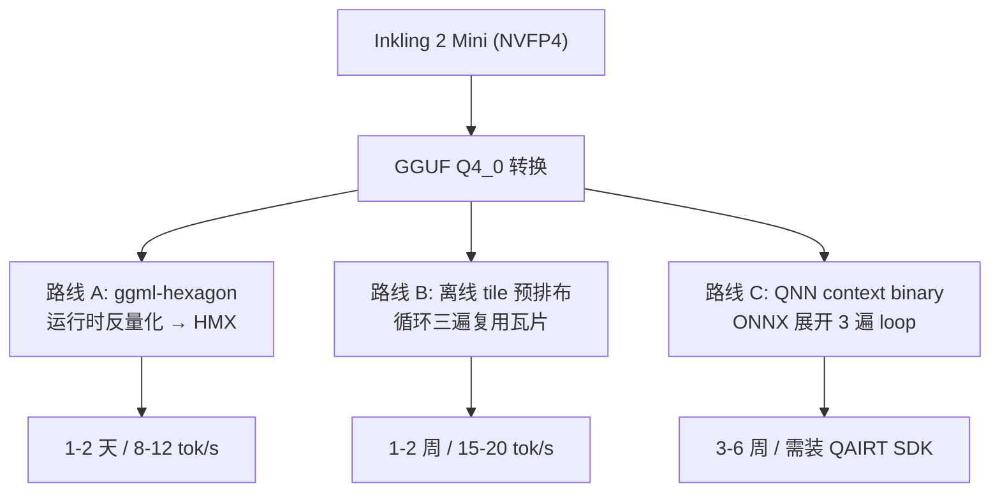

Thinking Machines Lab 在 2026 年 11 月 20 日发布 **Inkling 2 Mini**：一个 26.4B 总参数、3.4B 激活的循环 Transformer（looped transformer），中间层对每个 token 跑三遍，官方权重原生 **NVFP4**、最后四层 MXFP8，整包约 20 GB。

这篇文章回答三个问题：**高通有没有官方优化版**、**本机 GenieX 到底具备什么能力**、**如果要自己把它改成 HMX 特化模型需要做什么**。所有结论都来自本地二进制与线上仓库的实际核查，不是文档推断。

---

### 系列导航

这是四篇连载，记录把一个刚发布的新架构模型搬到 Snapdragon X Elite 上的全过程。每篇都可以单独读，但结论是递进的：

| 篇 | 内容 | 一句话结论 |
| :--- | :--- | :--- |
| **一（本篇）** | 高通优化缺位、GenieX 算子盘点、HMX 特化路线 | 没有任何现成 NPU 产物，必须自己转 |
| [二：dense 与 MoE 的分工边界](/post/snapdragon-x-elite-dense-vs-moe-boundary) | 四条计算路径的实测对照 | 8B dense 归 CPU，26B MoE 归 NPU |
| [三：两道门与一个封闭的 DSP](/post/npu-signed-skel-lock-in) | 签名与协议为什么绕不过去 | 自定义 host 配不上签名 skel，NPU 这条路封死 |
| [四：CPU、Vulkan 与 OpenCL 实测](/post/inkling-2-mini-cpu-gpu-vulkan-opencl) | 退而求其次的真实性能 | 最好的 GPU 方案在 prefill 上落后 CPU 十倍 |

如果只读一篇，建议直接看[第三篇](/post/npu-signed-skel-lock-in)——签名锁定这件事不只影响 Inkling，任何新架构模型都会撞上同一堵墙。

---

## 1. 模型画像

| 项目 | 数值 |
| :--- | :--- |
| 总参数 / 激活参数 | 26.4B / 3.4B |
| 每 token 等效激活（含三遍循环） | 5.4B |
| 原生数值格式 | NVFP4，最后 4 层 MXFP8 |
| 权重体积 | ~20 GB（19.53 GB 主权重 + 0.64 GB MTP 头） |
| 上下文 | 1M token |
| 许可证 | Apache 2.0 |
| 官方基准 | DeepSWE v1.1 48.2%、Vals Index v2.2 46.5% |

循环结构是关键：**同一套物理权重被复用三次**。这既是它在同尺寸下推理质量更高的原因，也是移植到 NPU 时唯一可以利用的结构性红利——下文第 5 节会展开。

---

## 2. 高通有没有针对它优化？

没有。三条独立证据：

**（1）官方 model card 的部署清单。** 只列了 Apple Silicon（Ollama、Exo Labs）与 NVIDIA（SGLang、vLLM、Unsloth、NVIDIA Dynamo、Tokenspeed、llama.cpp），外加量化 GGUF。整份文档里 `Qualcomm`、`Snapdragon`、`QNN`、`ONNX` 出现次数均为 0。

**（2）Hugging Face 生态扫描。** 按 `inkling` 检索到的 100 个仓库里，量化版本只有 GGUF、MLX、NVFP4、FP8、EXL3 几类，带 `onnx` 过滤的结果为空，也没有任何 `qnn` / `snapdragon` 标签的产物。

**（3）Qualcomm AI Hub 目录。** 针对本机（Snapdragon X Elite CRD）列出的 20 个可运行模型里没有 Inkling，整个模型库也没有。

结论：**这条路上没有任何现成的 NPU 产物可以使用，必须自己做转换。**

---

## 3. 体积与下载

官方仓库是 **非门禁**（`gated=false`），不需要 token。但仓库体积差异极大，选错档位会白下几百 GB：

| 仓库 | 档位 | 体积 |
| :--- | :--- | :--- |
| `thinkingmachines/Inkling-2-Mini` | 原生 NVFP4/MXFP8 | 20.19 GB |
| `unsloth/Inkling-2-Mini-GGUF` | UD-Q4_K_XL（推荐） | 17.63 GB |
| 同上 | UD-Q2_K_XL | 9.14 GB |
| 同上 | Q8_K_XL | 22.87 GB |
| `ggml-org/Inkling-2-Mini-GGUF` | BF16 | 52.23 GB |
| `mlx-community/Inkling-2-Mini-4bit` | MLX 4bit | 17.33 GB |

注意 `unsloth/Inkling-2-Mini-GGUF` 整个仓库有 **266.71 GB**——每个量化档都同时提供了私有 layout 与 `Mainline_Support/` 两份。不加过滤会下满全仓：

```powershell
pip install -U "huggingface_hub[hf_transfer]"
$env:HF_HUB_ENABLE_HF_TRANSFER = "1"

hf download unsloth/Inkling-2-Mini-GGUF ^
  --include "Inkling-2-Mini-UD-Q4_K_XL.gguf" "mmproj-*.gguf" ^
  --local-dir D:\models\inkling2mini
```

另外，根目录那批 GGUF 使用 Unsloth 自己的循环层布局，必须配 Unsloth 的 llama.cpp 构建（`b12588-mix-c0c3de8`）；上游 mainline 要用 `Mainline_Support/` 里的那份。**GenieX 的 llama_cpp 后端就是 mainline，这一点直接决定后面能不能跑。**

---

## 4. 本机 GenieX 的算子家底

`geniex version` 与 `geniex config list` 的实际输出：

```text
GenieX CLI Version:     v0.11.0
QAIRT Runtime Version:  2.50
LlamaCPP Runtime Hash:  93cf736
chipset: Snapdragon X Elite CRD
```

安装目录下只有两条执行路径：

- `llama_cpp\`：`ggml-cpu.dll`、`ggml-opencl.dll`（Adreno GPU）、`ggml-hexagon.dll` + `libggml-htp-v73.so`（Hexagon NPU）
- `qairt\htp-files\`：QNN HTP 原生运行时（`libQnnHtpV73.so`、89 MB 的 `QnnHtpPrepare.dll`），只服务 `qualcomm/*` 这类预编译模型

从二进制符号里提取的三个后端特化算子（`libggml-htp-v73.so` 有 761 个内核符号，`ggml-opencl.dll` 有 92 个 `__kernel` 定义）：

| 算子族 | NPU（HTP v73） | GPU（Adreno OpenCL） | CPU（ARM64） |
| :--- | :--- | :--- | :--- |
| 量化矩阵乘 | HMX 引擎 `hmx_mm_2d_f32`；HVX 兜底 | `gemv/gemm` q4_0/q5/q6_k/q8_0/mxfp4 | NEON+DOTPROD 反量化点积 |
| MoE 分组 GEMM | `hmx_mm_id_2d_f32`、`hvx_mm_id_nx` | `gemv_moe_*` + histogram/scatter/combine | 通用 `mul_mat_id` |
| 注意力 | `hmx_flash_attn_ext`、GQA/mask 广播 | flash-attn × 量化变体、xmem 分块 | 通用实现 |
| 视觉前端 | `conv2d_dw`、`im2col`、`pool`、`upscale` | 走 xmem 打包 GEMM | 通用实现 |
| 权重反量化 | q1_0/q2_0/q4_0/q4_1/q8_0/q2_k~q6_k/IQ4_NL/MXFP4 | 同类子集 | 全格式 |

两个致命细节：

1. **HMX 只吃 fp16 瓦片。** 所有进矩阵单元的路径都是 `dequantize_tiled_weight_to_fp16_task_*` 或 `convert_*_to_fp16_tiles_task`，没有任何 int8 HMX 通路。
2. **NVFP4 三端皆无。** QNN 侧也只有 `mxfp4_to_fp16`。

---

## 5. 转成 HMX 特化模型要做什么

### 5.1 先想清楚"特化"是什么意思

不是把权重量化成某种 NPU 格式存盘，而是：**权重保持量化存放在 DDR，计算时按 HMX 的 tile 布局流式反量化为 fp16 瓦片送进 VTCM**。想预展开成 fp16 全量存盘会直接爆——26.4B × 2 B ≈ 53 GB，32 GB 机器放不下。

### 5.2 三条路线



| 路线 | 做法 | 工作量 | 主要风险 |
| :--- | :--- | :--- | :--- |
| A | 转 Q4_0 GGUF，交给 ggml-hexagon 每 token 反量化 | 1-2 天 | 重复 dequant，带宽利用率低 |
| B | 改 loader 预打包 HMX tile；循环三遍共享驻留瓦片 | 1-2 周 | 要改 C++ 后端与 GGUF 元数据 |
| C | ONNX 展开 loop → qnn-onnx-converter → HTP 二进制 | 3-6 周 | 本机无 QAIRT SDK；MoE gather/scatter 大概率过不去 |

### 5.3 执行顺序

**P0 可行性闸门**：先让 26B 级 MoE 在 HTP 上稳定跑通（见系列第二篇的实测），否则后面全是空谈。

**P1 拿 GGUF**：优先 `Mainline_Support/` 的现成产物，自己转需要 loop-aware 的 `convert_hf_to_gguf.py`，否则循环层会被压成一套静态层，模型直接失效。

**P2 量化选型**：选 **Q4_0**——不是质量最优，而是 HTP 的 `q4_0` 反量化 tile 内核最成熟，AI Hub 自家的 `qualcomm/*` 模型也都用它。Q4_K 次之，IQ4_NL 有专用内核。**不要试图用原生 NVFP4**。

**P3 HMX 对齐**：`GGML_HEXAGON_MM_SELECT=hmx`，把 M/N/K 对齐到 tile 边界——后端里有一条现成告警 `skip MUL_MAT_ADD fusion: HMX efficiency reduced`，维度不齐会直接掉回 HVX。再用 `OPTRACE`/`PROFILE` 抓 CPU 回退。

**P4 循环红利（唯一真正的结构优化）**：三遍循环共用同一套权重，标准路径下要重复读取并反量化三次。若把同层 fp16 瓦片在三个 pass 间驻留 VTCM/L2，权重读取降到 1/3。这是 Inkling 相比普通 26B MoE 唯一值得改后端的地方。

**P5 打包**：放好 GGUF + mmproj + `geniex.json`（`PluginId: llama_cpp`、精度标 `Q4_0`），`geniex list` 能看见即可 `geniex infer local/... -c npu`。

---

## 6. 小结

- 高通**没有**任何针对 Inkling 2 Mini 的优化产物，官方部署清单里连 Qualcomm 都没出现。
- 本机 GenieX 的 NPU 路径对 MoE 是友好的（有 `hmx_mm_id_2d_f32`），但对 **NVFP4 完全无能**，必须重量化成 Q4_0。
- 真正的 HMX 特化 = 量化权重 + tile 布局预排 + 循环三遍的瓦片复用，工作量按 A→B 递进，C 路线要先补 QAIRT SDK。

下一篇用实测数据回答更现实的问题：**这台机器上，NPU 到底该跑 dense 还是 MoE。**
