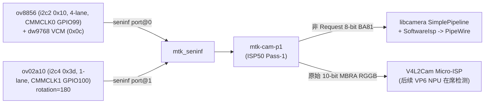

在给 **Lenovo Chromebook Duet (`google,krane-sku0`, MT8183)** 装上主线内核与 Nura / postmarketOS 之后，面板、Wi-Fi、音频与基础外设早已跑通，唯独前后面两颗摄像头长期处于“硬件在板上、驱动在旧树”的失联状态。

这篇整理了 **`mt8183-isp50-port`** 项目的完整移植脉络：如何把联发科仅留在 `chromeos-5.10` 树外的 **ISP50 Pass-1 + SENINF** 驱动体系前向移植到 **Linux `6.18.36` / `7.4-rc4`**，并跨越没有闭源 ChromeOS 3A HAL 的鸿沟，靠 **非 Request 8-bit Bayer 捕获 + `libcamera` `SimplePipeline` SoftISP** 在真机上同时点亮前后双摄。

---

## 1. 为什么主线 Linux 下 Duet 相机长期不可用？

检查主线 Linux `6.18.36` / `7.4-rc4` 下的 `mt8183-kukui-krane-sku0.dtb`，其实底层基建早就已经合入上游：
- `camsys` 时钟/电源域、`larb3` / `larb6` IOMMU、`mtk_scp` 协处理器驱动；
- `mt6358` PMIC 相机供电轨（`vcamio`、`vcamd`、`vcn18`、`vcama1`、`vcama2`）；
- 前后摄标定参数 `eeprom@50` / `eeprom@58`。

**真正缺失的有两块**：
1. **内核侧**：`drivers/media/platform/mediatek/isp/isp_50/`（即 `mtk_seninf` 与 `mtk-cam-isp`）从未合入主线，仍停留在旧版 `chromeos-5.10` 核中；`krane` 设备树也缺少两颗传感器到 `seninf` 的连接节点。
2. **用户态侧**：ChromeOS 使用闭源 `cros-camera-hal-mt8183` 3A HAL，强依赖 glibc、Android HAL3 与 Mojo IPC，而 Nura / postmarketOS 采用 musl + **PipeWire + `libcamera`**。如果不让 `mtk-cam-p1` 在不依赖复杂 V4L2 Request API 与闭源 P2/DIP 调参的前提下直接吐出标准 Bayer 帧，现代 Linux 桌面和浏览器根本用不上这颗摄像头。

---

## 2. 硬件拓扑与主线 Devicetree 对齐

`google,krane-sku0` 上的物理链路分成两条 MIPI CSI-2 通路接入 `seninf`，再汇聚进 `mtk-cam-p1` 并分流到两条软件消费路径：

在编写 `0003-arm64-dts-mediatek-mt8183-krane-cameras.patch` 对齐主线设备树时，需要特别注意两处上游 Schema 约束差异：

1. **单时钟绑定对齐 (`maxItems: 1`)**：
   - `chromeos-5.10` 中传感器常写 2 个时钟加 `freq_mux`，但主线 `Documentation/devicetree/bindings/media/i2c/ovti,ov8856.yaml` 和 `ovti,ov02a10.yaml` 严格限制 `clocks` 只能有 `1` 项（分别是 `"xvclk"` 和 `"eclk"`）。
   - 主线写法保持 `maxItems: 1`，同时通过 `assigned-clock-parents = <&topckgen CLK_TOP_UNIVP_192M_D8>` 把 `CLK_TOP_MUX_CAMTG` / `CLK_TOP_MUX_CAMTG2` 直接锚定到 `24 MHz` 参考时钟，保证 `ov8856`（GPIO99）与 `ov02a10`（GPIO100, `rotation = <180>`）稳定起振。
2. **主线 SCP 原生就绪**：
   - 检查 Linux `6.18.36` 和 `7.4-rc4` 的 `include/linux/remoteproc/mtk_scp.h`，上游早已内置 `SCP_IPI_DIP`、`SCP_IPI_ISP_CMD`、`SCP_IPI_ISP_FRAME` 以及 `scp_ipi_*` / `scp_mapping_dm_addr` 接口，因此无需改动 `remoteproc/mtk_scp` 即可直接对接 ISP50。

---

## 3. 内核 API 前向移植 (`chromeos-5.10` → `6.18.36` / `7.4-rc4`)

把一套 `5.10` 时代的 V4L2/Media-Controller 大型平台驱动搬到 `6.18+`（乃至 `7.4-rc4`），主要集中在 `0001`–`0004` 四个补丁的现代内核 API 迁移：

- **V4L2 异步子设备与状态模型**：
  - 旧 `v4l2_async_notifier_*` / `v4l2_async_subdev` 全部迁至 `v4l2_async_subdev_nf_init()`、`v4l2_async_connection`、`v4l2_async_nf_add_fwnode_remote()` 与 `v4l2_async_nf_register()`。
  - `init_cfg` 与 `v4l2_subdev_get_try_format()` 已移除，改用 `v4l2_subdev_internal_ops.init_state`、`v4l2_subdev_state_get_format()` 与 `v4l2_subdev_lock_and_get_active_state()`。
  - 在 `mtk_cam.c` 修复 Media Pad 初始化时序，先完成 subdev 与 pad flags 初始化再注册 `media_entity_pads_init`。
- **Media Pipeline 与 VB2 队列现代化**：
  - 移除已废弃的 `entity->stream_count` 与 `pipeline.streaming_count`，切为 `media_pipeline_start(&node->vdev_pad, ...)`、`media_pipeline_stop(&node->vdev_pad)`、`cam->pipeline.start_count` 与 `media_entity_is_streaming()`。
  - `vb2_ops` 移除 `.wait_prepare` / `.wait_finish`，并设置 `vbq->min_queued_buffers = 0`。
- **UAPI 格式、PM 与双版本脚本兼容**：
  - `0001-media-uapi-add-mtk-isp50-formats.patch` 补齐 `V4L2_PIX_FMT_MTISP_*`（含 10-bit Packed `MBRA` 与 Meta FourCC）及 `v4l2-ioctl.c` 描述；
  - `platform_driver.remove` 改为 `void`，电源管理升级为 `DEFINE_RUNTIME_DEV_PM_OPS` / `SYSTEM_SLEEP_PM_OPS` + `pm_ptr()`，`dma_map_resource()`、`snprintf(sd->name, ...)` 与非 legacy workqueue 清理同步到位；
  - 面对 `6.18` 与 `7.0+` 间 `seninf_set_fmt()` (`v4l2_subdev_client_info`) 等少数签名差异，仓库通过 `#if LINUX_VERSION_CODE >= KERNEL_VERSION(7, 0, 0)` 守护，并由 `scripts/export-upstream.sh` 按目标分支自动裁剪导出干净补丁集。

---

## 4. 关键一跃：非 Request 8-bit Bayer + `libcamera` SoftISP

如果 ISP50 P1 只能走 V4L2 Request API + MTK 私有 Meta 调参流，通用 Linux 相机生态依然用不起来。在补丁演进到 `r6` 阶段后，我们在驱动与 `libcamera` 之间打通了一套**开箱即用的开源软件通路**：

1. **驱动内建非 Request 作业路径（`mtk_cam.c`）**：
   - 在 `VIDIOC_QBUF` 路径识别非 Request 入队缓冲，构造内部自管理的 `req->is_internal` + `refcount_t` 帧作业生命周期，从而在无外部 Media Request 绑定时也能驱动 P1 Pass-1 正常跑满硬件流水线。
2. **硬件 10-bit → 8-bit Bayer 下变位 + Format Enumeration 过滤**：
   - `mtk_seninf` 完成 sink → source `pad4` 格式传播；`mtk-cam-p1` 打通直通 subdev `.pad` / `.internal_ops`，允许上游传感器输出 `10-bit`（如 `SRGGB10` / `SGRBG10`），经 Pass-1 硬件实时压为标准 8-bit Bayer `BA81` 输出给通用视频节点，同时开启 `V4L2_CAP_IO_MC` 与按 `f->mbus_code` 过滤格式枚举。
3. **`libcamera` 只需 1 行接入 (`0005-libcamera-simple-Enable-softISP-for-mtk-cam-p1.patch`)**：
   - 在 `src/libcamera/pipeline/simple/simple.cpp` 的 `supportedDevices[]` 表中添加 `{ "mtk-cam-p1", {}, true }`，立即唤醒 `SimplePipelineHandler` + CPU `SoftwareIsp`（完成软件去马赛克、AE/AWB/CCM，并输出标准的 `ABGR8888`/`sRGB` 帧给 PipeWire 与 GNOME Snapshot）。

---

## 5. 实机点亮结果与本地构建

最终在 Lenovo Chromebook Duet (`mt8183-kukui-krane-sku0`, Linux `6.18.36-mt81`) 上测得端到端稳定采集性能：

| 摄像头 | 传感器 / 通路 | 实测 `libcamera SoftISP -> PipeWire` 输出 | 帧率 |
|---|---|---|---|
| **后置主摄** | `ov8856` (`2-0010`) + `dw9768` VCM (`2-000c`) | `3276×2464-ABGR8888/sRGB` (GNOME Snapshot) | **`~37.5 fps`** |
| **前置副摄** | `ov02a10` (`4-003d`) | `1596×1200-ABGR8888/sRGB` (GNOME Snapshot) | **`~30.0 fps`** |

同时 `scripts/build-apk-container.sh` 支持在 Apple Silicon macOS 上通过 Apple `container` CLI 直接构建带 `abuild` 签名的 Nura/postmarketOS 内核 APK 包，用于个人设备快速安装与回滚。

> 仓库与上游规范注记：`mt8183-isp50-port` 借助 AI 工具完成移植与文档整理，遵循 Nura 与 `libcamera` 的 AI 贡献禁令，补丁集仅限个人与本地构建使用。

下一篇将进入第二块硬件拼图：如何在同一颗 MT8183 上把两颗长期沉睡的 **525 MHz Cadence Vision P6 NPU/DSP** 从主线 Linux 内核驱动和裸机固件一路唤醒。
