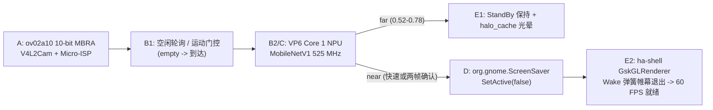

在一台运行 Debian 13 + Wayland (`phoc` + `ha-shell`) 的 **MediaTek MT8183 (`google,krane-sku0`, Lenovo Chromebook Duet)** 智能家居中控平板上，我们已经跑通了完整的端侧视觉在席唤醒闭环：前置 `ov02a10` RAW 传感器经 `V4L2Cam` Micro-ISP 输出 `96×96` 灰度图，送入 **Cadence VP6 Core 1 (`525 MHz`)** 执行 INT8 MobileNetV1 `person_detect.tflite`，通过会话 D-Bus (`org.gnome.ScreenSaver`) 唤醒处于零 FBO StandBy 锁屏帷幕中的 `ha-shell`（Panfrost **Mali-G72 MP3**, `GskGLRenderer`, `DSI-1` `1200×1920 @ 1.5× / 59.90 Hz`）。

功能虽已顺滑，但把**人在摄像头前入镜 → 屏幕彻底展开交互面板**整条物理链路拆开跑全栈 benchmark 后，立刻暴露出一串平时单测看不见的微秒/毫秒级开销，甚至抓到了一个只在 `far` 识别光晕阶段触发的 **GPU 掉帧回退（`49.99 FPS`）**。

本文记录了这次从底层 DMA 内存扫描到 GPU 纹理合成的全链路实测与五级优化。

---

## 1. 端到端唤醒链路与状态机

整个在席系统将房间空间划分为 `empty`（无人）、`far`（远距经过，保留微光时钟帷幕并给一次顶部柔和青绿/暖红识别光晕）与 `near`（走近操作，唤醒进入交互仪表盘）三态：

---

## 2. 优化前真机基线与六大瓶颈

在动手改代码前，我们先在真机（室内实测 `7–8 lx` 与日光环境对比）对每一段做了隔离与串联计时，基准数字非常诚实：

| 环节 | 优化前实测 (`p50`) | 暴露出的问题 |
|---|---|---|
| 空闲轮询等待（物理入镜等待） | `500–750 ms`（`1.0–1.5 s` 周期） | 房间完全静止时也每秒跑完整 VP6 推理，入镜平均要等半个多周期 |
| `V4L2Cam` 缓存抓帧 + ISP | `~65–68 ms` | 列优先遍历非缓存/WC V4L2 MMAP 缓冲里的 `1200×1200` 10-bit 像素，CPU 读放大极重；且 `wait_fresh==0` 在 `N_BUFS=3` 填满后会丢帧回落到阻塞 `poll()` |
| 传感器帧周期 (`ov02a10`) | 日光 `76.51 ms` (`vb=2000`) / 暗光 `172.39 ms` (`vb=6000`) | 暗光 `exp=4167` 硬套 `vb=6000`，白白多等 70 ms 消隐 |
| 帧间运动差 (`motion_mad`) | `0.51 ms` (Python `zip`) | 纯 Python 字节循环 |
| 两帧确认 (`Cap+ISP+NPU × 2`) | 日光 `460.10 ms` / 暗光 `452.26 ms` | 单帧硬件仅 `159.98 ms`，但抓帧等待 + CPU ISP 叠出了 ~68 ms/帧冗余 |
| D-Bus 唤醒 (`wake_from_standby`) | `~18.3 ms` | 每次唤醒先同步 `GetActive()` 再同步 `SetActive(False)` 两次 RPC，最高抖到 `58.5 ms` |
| `ha-shell` Wake 帷幕收拢 | `499.70 ms` (`veil 505.23 ms`) | `HA_SPRING_VEIL_WAKE.response = 0.36` 在 `near` 触发后仍略显拖沓 |
| `ha-shell` **`far` 识别光晕** | **`49.99 FPS` (`p95 = 33.37 ms`, `p99 = 50.05 ms`)** | **实测捕获掉帧！** `gtk_snapshot_append_radial_gradient` 每帧对 `1920×1200`（`2.3M px`）跑全屏径向片元着色器，把 Mali-G72 MP3 打满丢帧 |

优化前从真实走近画面到桌面动画完全收拢，典型耗时 **`~1.72 s`**（首帧进入管道后也要 **`~0.97 s`**）。

---

## 3. 五级全链路优化实践

### 阶段 A：Micro-ISP 行缓存 NEON 化 + V4L2 环形缓冲修复 (`v4l2_cam.c`)

1. **解决非缓存 DMA 随机读灾难**：ARM64 Linux 的 V4L2 MMAP DMA 缓冲通常是 Write-Combine / Non-Cacheable 映射。原 `downsample_bayer_common()` 按输出像素 `(oy, ox)` 外循环直接跨行按单字节索引 `src`，等效反复从非缓存总线拖小包。
   - 改为**行优先单次扫描**：为宽度 `<= 640` 分配栈累加器 `acc_r/g/b[640]`；每处理一对 Bayer 输入行 `(y, y+1)`，先用带 64 字节对齐的栈行缓冲 `row0_buf[2048]` / `row1_buf[2048]` 执行顺序 `memcpy()`，借助 glibc ARM64 NEON burst 读将一段扫描线一次性拉入 CPU L1 缓存后再做 10-bit 5-byte 解包与统计。
   - 在高倍率下采样（如 `1200×1200 → 96×96`，每块 `12×12` 像素）启用平衡行对步进 `y_step = 6`（而 `320×240` 等高分辨率保持全采样不丢锐度），配合 `Makefile` 启用 `-O3`。
2. **修复 `grab_common()` 满队列误丢帧**：当 VP6 推理（`~160 ms`）期间 `N_BUFS = 3` 个 V4L2 缓冲全部写满时，原第 3 次循环仍见 `POLLIN` 成立，触发 `if (++drained >= cam->nbufs) break;`，直接把第 3 帧最新图像也丢回队列，然后落入阻塞 `poll(&pfd, 1, 2000)` 多等一整个曝光周期！将快速分支条件改为 `drained + 1 >= cam->nbufs || poll(...) <= 0` 后，`wait_fresh == 0` 保证必取走最新就绪帧且永不误阻塞。
3. **NEON `v4l2_cam_motion_mad`**：在 C 侧直接用 `vabdq_u8 + vpaddlq_u8 + vpadalq_u16` 每次向量处理 16 像素，`9216` 字节 MAD 从 `0.51 ms` 降到 `0.01 ms`。

实测效果：带缓冲抓帧+ISP 从 **`~65–68 ms` 暴降至 `4.84 ms` (`p95 = 5.31 ms`，提速 `13.4×`)**，且中心 `p50_luma` 与 AWB 增益保持一致。

---

### 阶段 B & C：紧贴 VBLANK、运动门控快轮询与双门限快醒 (`vp6_proximity.py`)

1. **紧贴曝光的动态 `VBLANK` (`fit_vblank_for_exposure`)**：
   - 将传感器的垂直消隐严格贴合当前曝光行数 `exp - 1200 + 68`（按 `64` 行步进对齐，`min=1200`）。
   - 日光下 `vb` 从 `2000` 收到 `1200`（单帧周期 `76.51 ms → 57.34 ms`）；`7–8 lx` 室内暗光下（`exp=4167`）`vb` 从 `6000` 收到 `3072`（帧周期 **`172.39 ms → 102.22 ms`**，直接快出 `70 ms`）。
2. **空房 `4 Hz` 运动门控轮询 + `3.0 s` NPU 心跳**：
   - 借助刚才 `4.84 ms` 极低成本的相机+ISP+NEON MAD，当 `stable_state == "empty"` 时每 **`0.25 s`（`4 Hz`）** 只抓取画面算一次运动 MAD。
   - 若室温静默 (`motion_mad < 3.0`) **直接跳过 VP6 推理**，仅每 `3.0 s` 跑一次 NPU 心跳兜底静止目标。效果是一箭双雕：**物理入镜平均等待从 `750 ms` 降至 `~125 ms`**，同时无人待机期间 VP6 NPU 空转能耗反降约一半。
3. **安全的高置信度单帧快醒 vs. 常规两帧确认**：
   - 只有当 **运动跃变明显 (`motion_mad >= 4.5`)** 且 **MobileNetV1 单帧置信度极高 (`person_prob >= 0.92`)** 两个条件同时满足时，才跳过第 2 帧确认，在 **Frame 1 (`165.7 ms`)** 直接唤醒屏幕；其余常规阈值 (`0.78–0.92`) 或低运动场景继续保留两帧确认（且得益于阶段 A 优化，两帧总确认耗时也从 **`460.1 ms → 333.6 ms` 日光 / `362.0 ms` 暗光**）。
4. **大核亲和性绑定**：在 `vp6-proximity.service` 增加 `CPUAffinity=4-7`，避免 ISP 与 NPU 调度漂移到低频 Cortex-A53 小核。

---

### 阶段 D：异步缓存 D-Bus 调度 (`DisplayStandbyBridge`)

唤醒时刻的 `org.gnome.ScreenSaver` 状态几乎总能从前几秒的空闲轮询得知：
- 在空闲轮询帧里以 `5 s` 节流后台更新 `GetActive()` 缓存（`refresh_standby_cache()`）；
- 触发 `wake_from_standby()` 时直接读取 `12 s` 有效期内的状态缓存，并以 **`SetActive(False, ignore_reply=True)`** 异步发出 D-Bus 唤醒请求（已唤醒状态下连续 1 Hz 确认同样命中缓存直接返回，不再反复发同步 RPC）。

实测 `wake_from_standby()` 从 `~18.3 ms` 降到 **`0.45 ms` (`max = 0.54 ms`，提速 `~40×`)**。

---

### 阶段 E：根治 Mali-G72 `far` 光晕掉帧与收紧 Wake 弹簧 (`ha-shell`)

此前的零 FBO 优化已经通过预烘焙 `bg_cache` 与 `content_cache` 让纯 Wake/Sleep 循环跑满 `60 FPS`，但遗留了一个“盲区”：`far` 识别脉冲 `halo_alpha > 0` 时调用的 `gtk_snapshot_append_radial_gradient(&full)` 仍要在 `1920×1200` 全屏范围实时算片元梯度。

- **预烘焙 `160×100` (`64 KB`) 零 FBO `halo_cache` 纹理**：利用 `bake_standby_halo_texture(bedside)` 通过与面板一致的 `16:10` 比例离线由 Cairo 绘入 `GdkTexture`（与 `bg_cache` 共用 `cairo_surface_to_texture`），每帧渲染只需一次单 Texture Quad 透明合成 `Opacity(Texture(halo_cache))`，零 FBO 分配、片元计算量下降超 `140×`。
- **收紧 `HA_SPRING_VEIL_WAKE`**：将唤醒临界阻尼弹簧 `response` 从 `0.36` 调至 `0.29`（`damping_ratio = 0.96`），让字符与背景帷幕更利落让出主屏，同时保持原有单元测试断言与低功耗入眠节奏（`response = 0.54`）不变。

---

## 4. Before vs. After 真机实测总表

以下全部数据均为同一台 `ha` (`MT8183`) 优化部署后重启服务并在真机现场采集：

| 评测指标 | 优化前 (Baseline) | 优化后 (Optimized) | 变化幅度 |
|---|---:|---:|---:|
| **带缓冲 Grab + Micro-ISP CPU (`wait_fresh=False`)** | `~65–68 ms` p50 | **`4.84 ms` p50** (`5.31 ms` p95) | **`13.4×` 提速** |
| **传感器独立帧周期 — 日光** | `76.51 ms` (`vb=2000`) | **`57.34 ms`** (`vb=1200`) | **`-19.2 ms` (`1.33×`)** |
| **传感器独立帧周期 — 暗光 (`7–8 lx`)** | `172.39 ms` (`vb=6000`) | **`102.22 ms`** (`vb=3072`) | **`-70.2 ms` (`1.69×`)** |
| **帧间运动 `motion_mad`** | `0.51 ms` (Python) | **`0.01 ms` p50** (NEON) | **`51×` 提速** |
| **空房入镜平均轮询等待** | `500–750 ms` | **`~125 ms`** (`4 Hz` 门控) | **`~6×` 更快** + 空闲 NPU 减半 |
| **1 帧快速唤醒 (`Cap+ISP+NPU`)** | `224–228 ms` (旧 F1) | **`165.7–165.8 ms` p50** | **`-62 ms`**（`prob>=0.92 & mad>=4.5`） |
| **2 帧确认 (`Cap+ISP+NPU × 2`, 日光)** | `460.10 ms` p50 | **`333.61 ms` p50** (`336.24 ms` p95) | **`-126.5 ms` (`-27.5%`)** |
| **2 帧确认 (`Cap+ISP+NPU × 2`, 暗光)** | `452.26 ms` p50 | **`361.96 ms` p50** (`373.51 ms` p95) | **`-90.3 ms` (`-20.0%`)** |
| **D-Bus 唤醒派发 (`wake_from_standby`)** | `~18.3 ms` | **`0.45 ms` p50** (`0.54 ms` max) | **`~40×` 提速** |
| **`ha-shell` Wake D-Bus → 动画落定** | `499.70 ms` (`veil 505.23 ms`) | **`404.37 ms`** (`veil 406.61 ms`) | **`-95.3 ms` (`-19.1%`)** |
| **6 轮 Wake/Sleep 活跃 CPU 开销** | `159` jiffies / `9.3 s` | **`75` jiffies / `9.18 s`** | **`2.1×` 省 CPU** |
| **`far` 识别光晕脉冲 帧率 / `p95` / 掉帧** | `49.99 FPS` / `33.37 ms` | **`59.89 FPS` / `16.81 ms` / `0` jank** | **锁死 `60 FPS`，掉帧清零** |
| **`ha-shell` 5 秒静态 StandBy 开销** | `0` 帧, `5` jiffies | **`0` 帧, `4` jiffies** | **零帧休眠** |

把全链路加总回真实用户体感：
- **优化前**：`~750 ms` (平均入镜等待) + `~456 ms` (两帧确认) + `~18 ms` (D-Bus) + `~500 ms` (Wake 动画) ≈ **`~1.72 秒`**（首帧捕获起 **`~0.97 秒`**）
- **优化后（常规两帧确认）**：`~125 ms` + `~334–362 ms` + `~0.5 ms` + `~404 ms` ≈ **`0.86–0.89 秒`**
- **优化后（高置信单帧快醒）**：`~125 ms` + `~166 ms` + `~0.5 ms` + `~404 ms` ≈ **`0.70 秒`**（首帧捕获起仅 **`~0.57 秒`** —— **整条链路提速 `2.5×`**）

---

## 5. 小结

1. **在 SoC 上直接从 V4L2 MMAP 取原图时，先查缓存策略再写图像循环**：在 MT8183 这类非缓存 DMA 映射上，行优先 + 栈 `memcpy` 顺序拉流后再算，比直接在图像缓冲里跨行像素索引快出一个数量级（`65 ms → 4.84 ms`）。
2. **轮询延迟与空闲功耗不是天生对立的**：把极便宜的前端信号（`4.84 ms` 的 ISP + `0.01 ms` NEON 运动检测）拆到高频门控层，让高功耗 NPU（`160 ms`）只在触发事件和低频心跳时唤醒，能同时大幅降低响应延迟和后台平均算力占用。
3. **在移动端小核 GPU（Panfrost Mali-G72 MP3）上，连程序化渐变都要算像素账**：即使是零 FBO 的原生节点，每帧在 230 万像素上跑片元径向渐变依然会拖垮 `60 Hz` 帧预算；换成一张 `64 KB` 预烘焙小纹理拉伸采样，效果无损而帧率立刻锁稳 `59.89 FPS`（`0` jank）。
