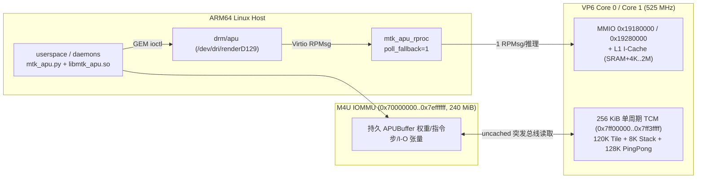

前四篇讲述了如何把 **Lenovo Chromebook Duet (`google,krane-sku0`, MT8183)** 的双摄和双核 Vision P6 从主线 Linux 内核驱动一路拉起，并把唤醒链路压到 `0.70 s`。

这篇作为本系列的**技术参考与实战手册**，集中把 **MT8183 Vision P6 (`MVPU6_0226`) NPU** 的底细摊开：**它的 ISA 架构是什么、理论算力与开源实测性能边界在哪里、内存与 I/O 总线如何流转、开源固件工具链怎么编、以及如何把你自己的模型编译量化并部署到 Home Assistant 生产栈里。**

---

## 1. 硬件与指令集架构 (ISA)：Xtensa LX7 底座 + 512-bit VLIW SIMD

MT8183 内部的两颗 APU 核心并不是某种固定功能的纯硬连线 ASIC，而是两颗独立运行在 **`525 MHz`** 的可编程 **Cadence Tensilica Vision P6 (`MVPU6_0226`) DSP**，控制端基座是一个标准的 **Xtensa LX7** 处理器核。

在开源主线环境下，整个 ISA 必须明确拆成两层来看：

| ISA 层 | 包含特性 | 开源工具链能否发射？ | 备注与真机实测验证 |
|---|---|---|---|
| **Xtensa LX7 标量 + 真机解锁指令** | `call0 ABI`、`mull` (`32×32→32`)、**`mulsh`/`muluh` (`32×32→高32位`)**、**`quou`/`quos` 硬件除法**、`nsau`、`mul16s`/`mul16u`、`min`/`max`、**`sext`/`clamps`** | **可以** (`as` 原生或 `.byte` 内联 / 纯汇编) | 真机实测全数精确通过：`mulsh(-1e9,1e9)=0xf21f494c`、`muluh(2^31,2^31)=0x40000000`、`quou(100000,7)=0x37cd`、`clamps(±200,7)=0x7f/0xffffff80`、`sext(0xff,7)=0xffffffff`；`ER 0x110000` (`IDMA_REG_SETTINGS`) 回读 `0x000000cc` |
| **硬件未配置 / 编译禁用的扩展** | `entry`/`retw` 窗口寄存器、**`MAC16` (`ACCLO`, `SR 16`)**、**零开销循环 (`LCOUNT`)**、**标量 `FPU`** | **禁止 / 硬件不支持** | 真机探测证实 `ACCLO (mac16)`、`loop (.byte 0x76,...)`、`FPU add.s` 均触发异常（**UNSUPPORTED**）；`Makefile` 用 `-mabi=call0` 禁用 windowed 扩展 |
| **Cadence Vision P6 3 个硬件协处理器 (`CPENABLE = 0x7`)** | `CP0` / `CP1` / `CP2` 硬件单元、512-bit 向量寄存器与 5-way FLIX VLIW、`256 INT8 MAC/cycle` | **不能** | 真机向 `CPENABLE` (`SR 224`) 写 `0xff` 稳态回读 **`0x00000007`**，证明硅片内实打实存在 3 个 TIE 协处理器，但编码与 `xt-clang` 均闭源 |

### 真机硅片硬件身份寄存器实测 (`trace0`)

为了不靠“规格书推断”，我们在 `firmware/hw_probe.c` 中用 `apu_probe_exec()` 对两颗激活核心 (`19180000.apu` & `19280000.apu`) 直接读取 Xtensa 特殊寄存器并测试指令异常行为，真机实测两核回显**完全一致**：

```text
ID: PRID = 0x00000000
ID: CONFIGID0 = 0xc0f3dbfe
ID: CONFIGID1 = 0x21069682
ID: CPENABLE init = 0x00000000
ID: CPENABLE mask = 0x00000007
OPT: LCOUNT (loop) = 0x00000000
OPT: ACCLO (mac16) = UNSUPPORTED
OPT: mulsh(-1e9*1e9) = 0xf21f494c
OPT: muluh(2^31*2^31) = 0x40000000
OPT: quou(100000/7) = 0x000037cd
OPT: clamps(200,7) = 0x0000007f
OPT: clamps(-200,7) = 0xffffff80
OPT: sext(0xff,7) = 0xffffffff
ER IDMA(0x110000) = 0x000000cc
```

这组数字给出了三条硬证据：
1. **双核硬件完全对称且指纹锁定**：两颗核烧录了同一套 Cadence XPG 构建签名 **`CONFIGID0 = 0xc0f3dbfe` / `CONFIGID1 = 0x21069682`**（注：硅片寄存器只存数字签名，不存 ASCII 字符串；`MVPU6_0226` 名称源自 BayLibre 开源 MT8183 `libAPU` 栈的 `lsp/MVPU6_0226` 目标配置目录，二者精确映射关系以联发科 NDA `core-isa.h` 为准）；
2. **三个 TIE 协处理器硬件确凿存在，同时标量算力底座远比 `sample_controller` 预设更完整**：`CPENABLE` 黏滞掩码 **`0x00000007`** 证实了 `CP0/1/2`；虽然物理上裁掉了 `MAC16`、`FPU` 与 zero-overhead `loop`，但实打实保留了 **`mulsh`/`muluh`（单条 32×32→高32位）、`quou` 硬件除法、`sext`/`clamps`** 与 **Xtensa iDMA 外部寄存器块 (`ER 0x110000 = 0x000000cc`)**——详见[第（六）篇：指令集深挖与性能跃迁实录](/posts/mt8183-vp6-isa-unlock-performance-turnover)；
3. **官方 vs. 开源加速路径**：在闭源生态（`xt-clang` + BayLibre `libAPU`）下全速路径是 `CPENABLE = 0x7` + `libidma` + Cadence `XI Library` / `NNLib`；而在开源栈中，把这批隐藏标量硬件指令全部解锁后，再配合 **`L1 I-Cache` + `115–128 KiB` TCM 分块 + 纯 Xtensa 零溢出汇编微内核 (`tcm_dot.S`)**，标量有效图级算力从早先 `10–96 MOPS` 跃升到 **`~130–179 MOPS`**，足以让语音唤醒和空间感知推理在原有延迟预算内直接提速 **27%–4.8×**。

---

## 2. 理论峰值算力 vs. 开源上限 vs. 真机实测性能

把物理算力、开源工具链理论天花板和真机实际跑通的网络放到同一张尺度下对比，能立刻看清哪些负载该往 VP6 放、边界在哪里：

### 三层算力推算

1. **硬件硅片理论峰值（闭源 512-bit TIE VLIW，双核 @ `525 MHz`）**
   - Vision P6 向量单元每周期理论吞吐为 `256` 次 `8-bit × 8-bit MAC`（每次 MAC 计 `2 Ops`：乘+加）：
     - 单核峰值 = $256 \times 2 \times 525\text{ MHz} = 268.8\text{ GOPS}$
     - 双核峰值 = $2 \times 268.8\text{ GOPS} = \mathbf{537.6\text{ GOPS}}$（**`~0.54 TOPS` INT8**，正好对应 MT8183 规格书宣称的 **`0.5 TOPS`**）
   - 若降为 `INT16 × 8`（`128 MAC/cycle`）约 **`268.8 GOPS`**，`INT16 × 16`（`64 MAC/cycle`）约 **`134.4 GOPS`**。

2. **开源标量 Xtensa LX7 天花板（无 TIE SIMD，双核 @ `525 MHz`）**
   - 仅使用 Xtensa LX7 标量 `mul16s`/`mull` 流水线时，理想单周期至多完成 1 次标量 MAC（$1 \times 2 \times 525\text{ MHz} = \mathbf{1.05\text{ GOPS/核}}$，双核合计 **`2.10 GOPS`**）。
   - 早先纯 C 编译版（`-O2` + 4 条 `mul16u` 软拼 64-bit Q31 重缩放）的有效图级吞吐落在 ~`10–96 MOPS`；通过解锁 **`mulsh`/`quou`/`sext`** + **`115 KiB` 动态 TCM GEMM 分块** + **零溢出纯汇编 `tcm_dot.S` 内核**后，图级真实有效算力已提升到 **`125–179 MOPS`**（`GEMM_I8 64×64×64` 实测 `5.85 cycles/MAC` 含拆包与重量化）。

### `mt8183-apu` 真机硅片实测汇总 (`525 MHz`)

| 测试负载 | 早先 I-Cache + TCM 基线 | **最新 (ISA 解锁 + `tcm_dot.S` 汇编)** | 相对加速与精度 |
|---|---|---|---|
| `GEMM_I8` `64×64×64` | `~8.3M cyc` / `17–26 ms` | **`1.535M cyc` / `11.77 ms`** (`179 MOPS`) | **`5.41×` 周期压缩**, `max_err = 0` |
| `CONV2D_I8` `16×16×8 → 16×16×16` (`3×3`) | `~11.2M cyc` / `23–30 ms` | *已并入整网/汇编微内核基准* | **Bit-exact** |
| `bench_nn.py` 8× 3 层 CNN+MLP (`406k MACs`) | `639.79 ms` (1C) → `333.29 ms` (2C) | **`494.21 ms` (1C) → `284.55 ms` (2C, `11.42 MOPS`)** | `3.54M cyc/帧`, `softmax max_err = 1.49e-09` |
| **Core 0 `microWakeWord` (`alexa.tflite`, `30 ms` 块)** | `~3.1M cyc` / `9.1–11.6 ms` | **`1.66M cyc` / `8.33 ms`** (`wakeword` CPU `0.00%`) | **`-46.5%` VP6 周期**, `max_abs_qdiff = 0` |
| **Core 1 `person_detect.tflite` (`MobileNetV1 0.25× 96×96`)** | `82.1M cyc` / `156.3–160.1 ms` | **`59.77M cyc` / `118.85 ms`** (`person.bmp`) | **`-27.2%` (`1.37×`)**, Bit-exact `0.9408` / `0.2711` |
| **Core 1 `VP6SpatialDepthNetRGB` (`96×96×3 → 12×12×5`)** | `45.8M cyc` / `87.2 ms` (`10.78 FPS`) | **`31.22M cyc` / `64.35 ms` (`15.54 FPS`)** | **`-31.8%` 周期 (`+44.2% FPS`)**, Bit-exact |

**核心结论**：如果跑 1080p YOLO 或多路实时视频分析，缺少 512-bit TIE SIMD 依然力所不及；但在解锁全部标量硬件指令并手写零溢出 TCM 汇编内核后，**16 kHz 语音唤醒已缩到 `8.33 ms`/块（近 4 倍实时余量）、`96×96` RGB 多任务在席+深度推理直达 `15.54 FPS`（`64.35 ms`/帧）、`MobileNetV1 0.25×` 压进 `119 ms` 内**——彻底支撑 24/7 家居推理与主 CPU 近零占用。

---

## 3. 内存视图、总线拓扑与 Memory I/O 机制

理解这颗 APU 性能优化的钥匙完全不在算术单元，而在 **Memory I/O 拓扑**。两颗核心分别挂载固定物理窗口、共享一个 M4U GEM IOVA 池，并各自独享高速片上 TCM：



### 精确地址空间表 (`firmware/apu_config.h` + `linker.ld.in`)

| 内存区域 | Core 0 地址 (`19180000.apu`) | Core 1 地址 (`19280000.apu`) | 大小 / Cache 属性 | 用途 |
|---|---|---|---|---|
| `SROM` | `0x50000000` | `0x50800000` | `64 KiB` / `NON_CACHEABLE` | `_ResetVector` |
| `SRAM` | `0x60000000` | `0x68000000` | `2 MiB` / 前 4K 关，**`+4K..2M` 开 L1 I-Cache** | `.vectors`、`+0x500 .resource_table`、`.text`/`.rodata`/`.data`/`.bss`、主栈顶 |
| `VRING0 / VRING1` | `0x60200000` / `0x60208000` | `0x68200000` / `0x68208000` | 各 `32 KiB` (`16` 槽×`4096` 对齐) / `NON_CACHEABLE` | Virtio 收发环 |
| `VDEV_BUF` | `0x60210000` | `0x68210000` | `1 MiB` (`512 B` 槽，`496 B` payload) / `NON_CACHEABLE` | RPMsg 控制报文缓冲区 |
| `TRACE` | `0x60310000` | `0x68310000` | `64 KiB` / `NON_CACHEABLE` | `trace0` 固件日志 |
| `GEM IOVA Pool` | `0x70000000..0x7effffff` | `0x70000000..0x7effffff` | `240 MiB` (两核共享) / `NON_CACHEABLE` | `APUBuffer`（权重、量化参数、`ApuGraphStep[]`、I/O 张量） |
| `Local TCM` | `0x7ff00000..0x7ff3ffff` | `0x7ff00000..0x7ff3ffff` | **`256 KiB`** (各自独立单周期) / `NON_CACHEABLE` | 120K Tile + 8K 栈 (`0x7ff1e000..0x7ff1ffff`) + 128K Ping-Pong |

### 四个决定吞吐与稳定性的 I/O 设计

1. **为什么“开 L1 I-Cache、刻意关掉 D-Cache”**？
   - Xtensa LX7 的 L1 D-Cache 若打开，每一次 Virtio `vrings`、`resource_table`、主机写入的权重/输入张量和输出张量都要手写精确定长线 invalidate/flush，任何 32 字节对齐偏差都会引入隐蔽脏数据。
   - 我们在 `firmware/mpu.c` 对 `[SRAM+0x1000, SRAM+2M)` 开启全部 5 路 **L1 I-Cache**（`MEMCTL = 0x00fc0000`），同时保持 **D-Cache ways = 0**，用片上 **256 KiB 单周期 TCM** 承接所有热点算子与调用栈（`TCM 256rd_cyc` 从 **`61,332 → 2,303` cycles**，提速 **`26.6×`**），兼得极速代码执行与 100% 硬件一致性。
2. **双 `64 KiB` `TCM_PINGPONG` 消除外部 DRAM 流量**：
   - 在 `0x7ff20000..0x7ff3ffff` 上段 `128 KiB` TCM 内划分两块 `64 KiB` 激活缓冲区。整个卷积网执行期间，输入和输出槽只在 `act0`/`act1` 间原地乒乓切换，DRAM 只在最首层输入、权重顺序读和末层写回发生传输。
3. **持久 IOMMU BO + 单次 `APU_CMD_EXEC_GRAPH`**：
   - 主机侧与 Python 运行时（`APUBuffer`）保持所有 DMA BO 长期常驻映射，每次推理只通过 BO `write()`/`read()` 与 1 次 `EXEC_GRAPH` IOCTL 通信。实测在 `person_detect.tflite` (`160.10 ms` wall vs `159.98 ms` 硬件 cycles) 中，整个 Python + `libmtk_apu.so` + 内核 RPMsg 往返通信开销仅有 **`0.12 ms`**！
4. **控制寄存器路径与 `poll_fallback=1`**：
   - 因 MT8183 VP6 访问 `0x19180000`/`0x19280000` 控制域走 M4U IOMMU (`larb=2/3 port=0`)，驱动设置 `poll_fallback=1` 收割完成队列；由于单次批处理整网已将 RPMsg 次数降到 `1` 次/帧，几乎无轮询开销。

---

## 4. 开源工具链与固件构建体系

整套开发无需任何联发科或 Cadence 私有工具，全部可在标准 Linux ARM64/x86_64 环境下零授权复现：

### Xtensa 固件编译 (`firmware/Makefile`)

使用的是 Zephyr Project 发布的开源 GCC 工具链 **`xtensa-sample_controller_zephyr-elf-`**，关键构建约束直接写死在 `CFLAGS_BASE` 与 `verify` 阶段：

```makefile
CFLAGS_BASE := -mabi=call0 -mlongcalls -mtext-section-literals \
               -O3 -ffreestanding -nostdlib -fno-builtin -Wall -Wextra -Werror \
               -DUSE_HW_MUL32
LDFLAGS     := -nostdlib -Wl,--build-id=none
SRCS        := start.S tcm_dot.S rsc_table.c trace.c hw_probe.c mpu.c virtio_rpmsg.c ops.c main.c
```

- `-mabi=call0`：彻底绕开 windowed 寄存器窗口溢出处理复杂度；
- `-mlongcalls -mtext-section-literals`：保证从 `SROM` (`0x50000000`) 跳转到 `SRAM` (`0x60000000`) 以及远距离常量的正确重定位；
- 双核链接脚本由唯一模板 [`linker.ld.in`](https://github.com/Tinnci/mt8183-apu) 通过 `sed` 自动实例化为 `core0.ld`（`0x50000000 / 0x60000000`）与 `core1.ld`（`0x50800000 / 0x68000000`）；
- 执行完链接后，`make verify` 还会用 `objdump -d` 审计是否误入了未验证扩展/windowed 指令。

```bash
# 1. 编译与审计双核裸机固件 (apu0.elf / apu1.elf)
make -C firmware clean verify TOOLCHAIN=/path/to/xtensa-sample_controller_zephyr-elf-
sudo mkdir -p /lib/firmware/mediatek/mt8183
sudo cp firmware/build/apu0.elf firmware/build/apu1.elf /lib/firmware/mediatek/mt8183/

# 2. 在 MT8183 本机编译用户态库与测试程序 (libmtk_apu.so)
make -C userspace
```

---

## 5. 推理引擎内部机制 (`APU_CMD_EXEC_GRAPH` `0x15U`)

用户态 (`userspace/mtk_apu.py` / `libmtk_apu.so`) 不靠笨重的解释器框架，而是把图直接压成一串紧凑的 `ApuGraphStep` 描述符数组交给 VP6 顺序跑完：

- **原生批处理原语（5 个核心 Op）**：
  1. `APU_GRAPH_OP_GEMM_I8`：将任意 `1×1 Conv2D`（stride=1, pad=0）直接转置权重作为高速稠密矩阵乘执行；
  2. `APU_GRAPH_OP_CONV2D_I8`：通用量化 2D 卷积（支持任意 `kh×kw`、步长与 `SAME`/`VALID` 填充）；
  3. `APU_GRAPH_OP_DEPTHWISE_CONV2D_I8`：MobileNet 系列主力深度可分离卷积，对主流 `3×3` 卷积核在 TCM 内专门做无分支高速特化；
  4. `APU_GRAPH_OP_AVGPOOL_I8`：全局或局部平均池化；
  5. `APU_GRAPH_OP_SHIFT_CONCAT_I8`：专供音频流式状态模型原地左移/拼接历史特征帧。
- **精确 TFLite INT8 语义转换**：
  - 主机加载器读取每个输出通道权重比例因子 $s_w$，按 $M = \frac{s_{\text{in}} \cdot s_w}{s_{\text{out}}}$ 经 `math.frexp` 分解为 `(q31_mult, rshift)` 写入权重 BO，并换算出精确 Fused `act_min`/`act_max` 边界（`NONE`/`RELU`/`RELU6`/`RELU_N1_TO_1`）。
- **激活值乒乓切换条件**：
  - 当模型中间最大单一输出/输入激活字节数 `max_act_bytes <= 65536` 时，直接开启 **`APU_GRAPH_FLAG_TCM_PINGPONG`**，两块激活张量常驻 `TCM`，速度可达全 DRAM 跑法的 **4–5 倍**。

---

## 6. 实战指南：训练、量化并部署模型到 Home Assistant

要在自己的 MT8183 平板上接入新的本地 AI 能力（无论视觉分类、传感器多任务回归还是音频事件），可以按以下标准工作流落地：

### 第一步：遵守 VP6 友好模型设计规范
- **全整数 INT8 量化**：权重与激活均用标准 `int8`（Per-Channel 权重对称量化 + Per-Tensor 激活非对称量化）；
- **算子集控制在 5 个原语内**：优先采用 `Conv2D 3×3 + DepthwiseConv2D 3×3 + Pointwise 1×1 Conv2D + AvgPool2D + Softmax` 结构（尽量把最终 Softmax 留在 ARM Host 对几个字节的 logits 算完，避免多余 DMA）；
- **峰值单层激活压在 `<= 64 KiB`**：例如 `96×96×3` 首层如果输出 `16` 通道 + `stride=2` 变成 `48×48×16 = 36,864 B`（`36 KiB <= 64 KiB`），即可全程触发 `TCM_PINGPONG`！若 `96×96` 输出过深导致单层超过 `64 KiB`，图引擎仍可正确降级跑在 IOMMU GEM BO 上，只是帧率会明显慢一截。

### 第二步：选择模型导出与运行路线

#### 路线 A：直接加载现成全整型量化 `.tflite`
`daemons/vp6_tflite_runner.py` 自带零外部依赖的纯 Python FlatBuffers 解析器（不需要装百兆级别的 `tflite-runtime` 或 TensorFlow）。在设备上几十行内即可直接跑起来：

```python
from vp6_tflite_runner import VP6PersonDetector

det = VP6PersonDetector("/opt/mtk-apu/models/person_detect.tflite", core=1)
# 输入 96x96 uint8/int8 字节流；act0_bo 持久驻留 IOMMU
res = det.infer_gray96(gray96_bytes)
print(res["person_prob"], res["cycles"], f"{res['vp6_ms']:.2f} ms")
det.close()
```

#### 路线 B：从 PyTorch 训练定制模型并导出 VP6 Graph JSON (`tools/presence_eval/`)
参考仓库中 `train_multitask_rgb_vp6.py` 与 `tflite_int8_sim.py` 的工作流（如 `VP6SpatialDepthNetRGB`）：
1. 在 Mac / PC（如 Apple Silicon MPS 或 CUDA）用 PyTorch 训练融合友好的 Conv+BN+ReLU6 小模型；
2. 折算并合并 Conv+BN 参数，校准每层输出激活 range，通过 `tflite_int8_sim.py` 验证 INT8 定点推理与浮点结果一致；
3. 导出打包的 `*_weights.bin`（32-bit 权重 + bias + `qparams_i32`）与描述步序的 `*_model.json`，在设备上像 `VP6SpatialDepthRunner` 一样零拷贝喂给 `apu.exec_graph()`。

### 第三步：通过三大接口接入 Home Assistant

| 集成目标 | 使用模块 | 通信协议与部署效果 |
|---|---|---|
| **HA 实体上报 (`binary_sensor` / `sensor`)** | `daemons/mqtt_lite.py` | 零依赖 MQTT 3.1.1 自动发送 HA MQTT Discovery 注册包（支持 **LWT `offline` 遗嘱**与断线自动重发 Discovery）；在席 Daemon 默认上线 `kukui_vp6_visual_presence`、`kukui_vp6_proximity` 与音频 `kukui_vp6_voice_activity` |
| **本地语音唤醒 / VAD (`wyoming`)** | `daemons/vp6_vad_proxy.py` + `vp6_microwakeword.py` | 作为 Wyoming 服务器监听 `127.0.0.1:10401`，将原本运行在 CPU 的 `wyoming-openwakeword` (`:10400`) 作为降级热备，直接向 `wyoming-satellite` 推送唤醒 `detection` 事件 |
| **本地平板交互与自愈保障** | `systemd/` + `ha_health.py` | `mtk-apu.service` 开机加载双核 ELF 固件；用户服务启用 `CPUAffinity=4-7` 固定大核；通过 `/run/user/10000/vp6-sensors.json` + `org.gnome.ScreenSaver` D-Bus 与 `ha-shell` 联动锁屏与唤醒；`ha_health.py` 统一校验服务、端口、容器、EC 充电阈值及 `iommu_faults = 0` |

至此，从内核设备树、裸机 Xtensa 固件、内存与算力剖析、开源工具链到全链路优化与 Home Assistant 生产落地，这台 2020 年发布的 MT8183 平板完成了它在开源主线 Linux 上的彻底翻新。如果你想看第 2/3 阶段基于真机硬件探测解锁 `mulsh`/`quou`/`sext` 与手写 `tcm_dot.S` 汇编微内核的完整性能跃迁实录（以及算力变宽后该投给“更低延迟”还是“更大模型”的定量决策），可继续阅读[第（六）篇：MVPU6_0226 隐藏指令解锁、零溢出汇编微内核与全栈性能跃迁](/posts/mt8183-vp6-isa-unlock-performance-turnover)。
