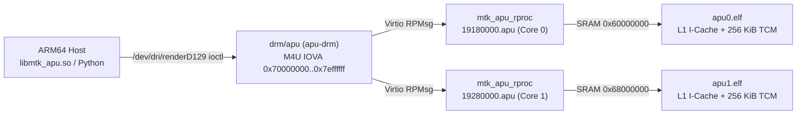

上一篇打通了前后摄像头，而同一颗 **MediaTek MT8183** 上还藏着两颗鲜被开源系统利用的 **525 MHz Cadence Tensilica Vision P6 (`MVPU6_0226`) NPU/DSP**。在没有 ChromeOS 闭源 `libedgetpu` / 联发科私有 DSP 固件包的前提下，要把它们在 Linux `6.18` 上真正唤醒、跑起 C 代码并稳定分配 IOMMU DMA 内存，需要同时解决 **电源域、共享 IOMMU、中断通路、Xtensa 裸机启动、MPU 缓存属性与 TCM 栈** 六道关卡。

本文对应 **`mt8183-apu`** 仓库及内核补丁 `0005`–`0009`，完整拆解从内核点亮到裸机固件起跑的底层细节。

---

## 1. 硬件架构与地址空间布局

MT8183 内部的两颗 Vision P6 核心在物理拓扑与内存视图上完全对称，同时共享一组 M4U IOMMU 地址空间供 Host ARM64 与双核 DSP 零拷贝交换权重与张量：

| 资源 | VP6 Core 0 (`vpu0`) | VP6 Core 1 (`vpu1`) |
|---|---|---|
| Devicetree 设备 | `19180000.apu` (`remoteproc1`) | `19280000.apu` (`remoteproc2`) |
| 保留固件 SRAM 基址 | `0x60000000` (`vpu0_mem`) | `0x68000000` (`vpu1_mem`) |
| 固件与 RPMsg 端点 | `apu0.elf` / `rpmsg-mt8183-apu0` | `apu1.elf` / `rpmsg-mt8183-apu1` |
| 主频与本地 TCM | `525 MHz`, `256 KiB` (`0x7ff00000..0x7ff3ffff`) | `525 MHz`, `256 KiB` (`0x7ff00000..0x7ff3ffff`) |
| 共享 M4U GEM IOVA | `/dev/dri/renderD129` (`0x70000000..0x7effffff`) | 共用同一个 `apu-drm` IOMMU 域 |

总体通信架构如下：

---

## 2. 内核 Bring-Up 路上的三道硬件坑 (`0005`–`0009`)

我们从 BayLibre 早年提交过 RFC 的 `drm/apu` 与 `mtk_apu_rproc` 出发，将其前向移植至 Linux `6.18`，但在真机冷启动 `remoteproc` 时接连踩中三个隐蔽故障：

### 坑 1：`MT8183_POWER_DOMAIN_VPU_TOP` 上电必遇 `-ETIMEDOUT`（补丁 `0009`）

第一次拉起 `vpu0` 时，`pm_runtime_get_sync()` 总是卡死 1 秒后以 `-ETIMEDOUT` 失败。翻查 `drivers/pmdomain/mediatek/mt8183-pm-domains.h` 才找到根因：
`MT8183_POWER_DOMAIN_VPU_TOP` 的 `.bp_cfg` 把 `MT8183_TOP_AXI_PROT_EN_MM_VPU_TOP` 整块配置成了普通等待 ack 的 `BUS_PROT_WR(...)`，但这个掩码里混进了通向 **ISP (`BIT(8)`)** 与 **CAM (`BIT(9)`)** 的跨域 AXI 桥接保护位。

**结果就是**：如果只启动 VPU 而不开启相机 ISP/CAM，对面模块处于断电态，`MT8183_TOP_AXI_PROT_EN_MM_STA1` 上 `BIT(8)`/`BIT(9)` 的 ack 永远不会清零！按照同文件里 `ISP_2ND` 和 `CAM_2ND` 的做法，将 `BIT(8) | BIT(9)` 拆出为 `BUS_PROT_WR_IGN`，其余核心位（`BIT(6) | BIT(7) | BIT(12)`）维持 `BUS_PROT_WR` 后，电源域毫秒级稳妥上电。

### 坑 2：卸载/出错回滚时 `rproc_disable_iommu()` 误拆共享域（补丁 `0005`）

`mtk_apu_rproc` 并不独占新建一条 IOMMU 域，而是通过 `iommu_get_domain_for_dev(dev)` 借用 SoC 级共享 M4U 域，并把内核框架标记置为 `rproc->has_iommu = false`。

但在主线 `drivers/remoteproc/remoteproc_core.c` 中，`rproc_disable_iommu()` 只检查 `if (!domain) return;`，却漏了 `!rproc->has_iommu` 判断。一旦一个 VP6 核心 `stop` 或初始化出错回滚，整个共享 IOMMU 域都会被 `iommu_detach_device` / `iommu_domain_free` 连带撕毁，立刻殃及另一颗 VP6 核心乃至 `camsys`！加上 `if (!domain || !rproc->has_iommu) return;` 后，双核即可安全独立反复启停。

### 坑 3：VP6 → ARM64 中断走过 M4U (`larb=2/3 port=0`) 与 `poll_fallback=1`

在 MT8183 上，VP6 固件写入 `0x19180000` / `0x19280000` 控制寄存器与门铃通道经过 M4U IOMMU（`larb=2/3 port=0`）而非旁路 APB。为了确保高并发、重加载与反复启停下 Virtio RPMsg 完成通知永不丢包，`mtk_apu_rproc` 默认启用 `poll_fallback=1` 对 virtqueue 做轻量轮询回收。配合下一篇引入的 **单次 RPMsg 批处理图引擎 (`APU_CMD_EXEC_GRAPH`)**，每次整网推理只需要 **1 次 RPMsg 往返**，轮询占用的 CPU 微乎其微。

---

## 3. 没有 Cadence 闭源 SDK：开源 Xtensa 裸机固件怎么写

Vision P6 的真正算力来自 Cadence 专有 512-bit SIMD ISA（`MVPU6_0226` TIE 扩展），但它只随需要商业授权的 `xt-clang` / Tensilica Xplorer 提供。好在基础 Xtensa LX7 标量与 DSP 整数管线（含单周期 `mull`、`mul16s`、`mul16u`、`min`/`max` 与双负载）完全兼容 **Zephyr 的开源 `xtensa-sample_controller_zephyr-elf` GCC 工具链**。

为了做出一颗“摔不坏、能自检、还能上高速缓存”的开源固件 `apu0.elf` / `apu1.elf`，我们在 `firmware/` 中写了完整裸机骨架：
- **启动与双重异常表 (`start.S`)**：进入 `_reset_trampoline` 后设置 `call0 ABI`、`INTLEVEL=15`、`VECBASE = SRAM_BASE`，并在 `.sram_vectors` 同时对齐铺设 windowed (`0x300..0x3c0`) 与 non-windowed (`0x200..0x280`) 两种 XEA2 异常向量偏移，哪怕未知指令或 MPU 试探发生异常都能精确跳入 `_exc_dump`；
- **非致命硬件探测 (`apu_probe_exec`)**：通过设置 `apu_probe_active = 1`，允许固件在运行时安全探测特定特殊寄存器或指令（触发异常仅记录 `exccause`/`epc1`/`excvaddr` 并无缝恢复），无需盲猜芯片配置；
- **32-bit 整数硬件乘法 (`mull`)**：启用编译期硬件乘法指令替换软件乘法例程——在双核并发矩阵测试里，仅这一步就先把基准从 `3,660 ms` 拉进了 `1,936.44 ms`。

---

## 4. 关键性能翻盘：MPU + L1 I-Cache + 256 KiB 单周期 TCM (`mpu.c`)

即便开启了 `mull`，初始版本一个 `64×64×64` INT8 GEMM 依然高达 `~196M cycles / ~376 ms`——**瓶颈卡在 Xtensa LX7 上电默认关闭指令缓存且前景 MPU 未分域**，每条指令和每次栈帧/累加器读写都要穿过 AXI 去抓外部 SRAM / DRAM！

### 单调边界编程与“只开 I-Cache、保持 D-Cache 全关”的巧解

Xtensa LX7 的 16 项前景 MPU 有一条铁律：**所有 MPU 段起始虚拟地址必须时刻保持单调非递减排序**，否则写 `wdtlb` 会当场引发硬件未定义状态或异常。在 `firmware/mpu.c` 的 `fn_mpu_program()` 中，我们严格按两步清零、降序填入 4 个核心区域：

| MPU 段号 | 地址区间 | 内存属性 | 作用与一致性策略 |
|---|---|---|---|
| `[n-4]` | `0x00000000 .. sram+0x1000` | `NON_CACHEABLE` | SROM、中断向量与 `.resource_table` |
| `[n-3]` | `sram+0x1000 .. sram+2M` | `WRITETHRU` (**开 I-Cache**) | `.text`、`.rodata`、`.data`、`.bss` |
| `[n-2]` | `sram+2M .. 0x7ff00000` | `NON_CACHEABLE` | Virtio `vrings`、`vdev0buffer`、`trace0` 与 GEM DMA |
| `[n-1]` | `0x7ff00000 .. 0xffffffff` | `NON_CACHEABLE` | `256 KiB` 本地 TCM 与硬件寄存器 |

随后设置 `MPUENB = 0x0000f000` 并向 `MEMCTL` 写入 `0x00fc0000`（打开全部 5 路 L1 **I-Cache** ways + `MEMCTL_INV_EN`，但 **故意将 D-Cache ways 保持为 `0`**）：
- **代码跑在 1-cycle L1 I-Cache**，热循环指令零取指停顿；
- **数据完全免维护软件 cache flush/invalidate**，因为主机与 DSP 交互的所有 `vrings`、`trace0`、`.resource_table` 与 GEM IOVA 缓冲天然 100% 一致；
- **真正热的数据放进 256 KiB 单周期 TCM (`0x7ff00000..0x7ff3ffff`)** 替代 D-Cache！

实机硅片跑出的验证数字直观到震撼：

- `TCM 256rd_cyc`：打开 L1 I-Cache 前需要 **`61,332` cycles** → 打开后骤降至 **`2,303` cycles**（**`26.6×` 提速**）。
- 我们将 `256 KiB` 宝贵的单周期 TCM 切成了三块黄金地段：
  1. **`0x7ff00000..0x7ff1dfff` (`120 KiB`)**：算子 tile 与输出累加器（`GEMM_I8` 采用 `TM=32, TN=32, TK=256`，4 路展开 `tcm_dot_2x2` + 寄存器化 `requant_one_i8_clamp`）；
  2. **`0x7ff1e000..0x7ff1ffff` (`8 KiB`)**：专供推理执行期间切换的 **1-cycle TCM 调用栈** (`apu_call_on_stack`)；
  3. **`0x7ff20000..0x7ff3ffff` (`128 KiB`)**：双 `64 KiB` 激活值缓冲，支撑多层 CNN 在不碰 DRAM 的情况下做片上 **`TCM_PINGPONG`** 乒乓传递。

硬件双核与片上高速通道已经全部打通。下一篇将展示这套裸机 + 内核基础设施如何演化成支持完整 TFLite INT8 图的批处理执行引擎，并在这台 MT8183 上把语音唤醒与视觉在席双双落地成 24/7 常驻服务。
