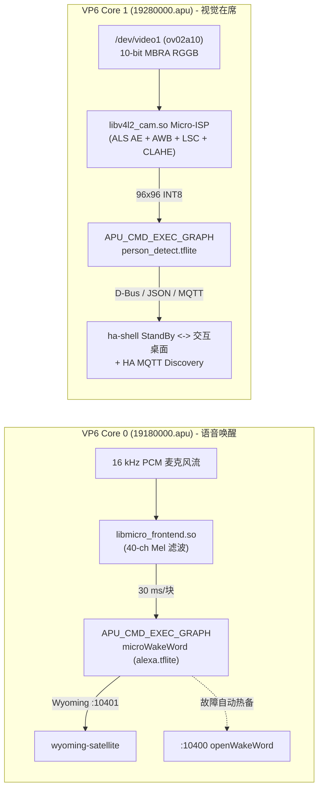

在上一篇点亮两颗 **MT8183 Vision P6 (`MVPU6_0226`)** 核、加上 L1 I-Cache 与 `256 KiB` 单周期 TCM 后，单算子从几百毫秒缩到了十余毫秒，但真要拿来跑 **Home Assistant 智能家居语音唤醒 + 前摄在席检测**，还差临门两脚：
1. 如果每层卷积都发一次 RPMsg，整张 MobileNetV1 二三十层来回的 IPC 与 DRAM 往返就会直接吞掉全部收益；
2. 需要一个真正持久、低维护的 Linux 用户态守护进程体系，把第一篇点亮的 `ov02a10` 摄像头、音频麦克风和双核 VP6 稳定串起来。

本文对应 `mt8183-apu` 的 `firmware/ops.c`、`userspace/` 与 `daemons/` 生产栈，讲清 **TCM 批处理图引擎** 如何落地，并汇报双核端侧 AI 在真机上的实测数据。

---

## 1. 单次 RPMsg 批处理图引擎 (`APU_CMD_EXEC_GRAPH` `0x15U`)

为了让整个神经网络像一张“一次下发、原地闭环执行”的微程序在 VP6 内部连续跑完，我们在固件中实现了 **`APU_CMD_EXEC_GRAPH` (`0x15U`)**：

- **持久化 IOMMU DMA 缓冲 (`APUBuffer` / `mtk_apu_bo_t`)**：模型权重、逐通道量化表、算子描述表 `ApuGraphStep[]` 与两块最大激活缓冲在服务启动时一次性分配并映射入 M4U IOVA (`0x70000000..0x7effffff`)，推理期间零 `alloc/mmap`。
- **内置算子与精确 TFLite 语义**：
  - 支持 `GEMM_I8`（1×1 Pointwise 卷积直转矩阵乘，TCM tile `TM=32, TN=32, TK=256`）、`CONV2D_I8`、`DEPTHWISE_CONV2D_I8`（针对 `3×3` 内部通道专门优化快速路径）、`AVGPOOL_I8` 与流式环形移位拼接算子 **`SHIFT_CONCAT_I8`**；
  - 完整支持 `APU_GEMM_FLAG_PER_CHANNEL` **逐通道 Q31 定点重缩放** 与 Fused `RELU/RELU6` 钳位，输出直接写为与 TFLite 参考解释器 **bit-exact** 的 INT8 张量。
- **`APU_GRAPH_FLAG_TCM_PINGPONG` + 8 KiB TCM 栈**：
  - 只要网络最大中间激活张量 `<= 64 KiB`（`MobileNetV1 0.25× 96×96` 恰好满足！），图引擎自动把两个激活槽放进上段 `128 KiB` TCM (`0x7ff20000..0x7ff3ffff`)，整张网几十层卷积全部在片上 **1-cycle TCM** 里来回乒乓传递；同时 `apu_call_on_stack` 将执行栈切到 `8 KiB` TCM 栈，完全消除运行时外部 DRAM 读写。

### 基础算子与整网硅片基准 (`google,krane-sku0`, `525 MHz`)

| 负载 | 优化前基线 | I-Cache + TCM + `EXEC_GRAPH` 优化后 | 数值精度 vs 参考模型 |
|---|---|---|---|
| `GEMM_I8` `64×64×64` | `~196M cyc` / `~376 ms` *(uncached)* | **`~8.3M cyc` / `17–26 ms`** | **Bit-exact** |
| `CONV2D_I8` `16×16×8 → 16×16×16` (`3×3`) | `~295M cyc` / `~567 ms` *(uncached)* | **`~11.2M cyc` / `23–30 ms`** | **Bit-exact** |
| `GEMM_F32` `32×32×32` | `~475M cyc` / `~912 ms` *(uncached)* | **`~25.6M cyc` / `55–56 ms`** | `max_err = 0` |
| `mtk-apu-test` 双核并发批测试 | `1,936.44 ms` *(无 `mull` `3,660 ms`)* | **`96–112 ms`** | 全部通过 |
| `bench_nn.py` 8× 3 层 CNN+MLP (`406k MACs/帧`) | — | **`639.79 ms` (单核) → `333.29 ms` (双核, `1.92×`, `9.75 MOPS`)** | Bit-exact INT8, `softmax max_err = 1.49e-09` |

---

## 2. 双核异构生产分工架构

在 Home Assistant 中控平板的 24/7 运行环境中，我们将两颗 VP6 核心彻底解耦成互不干扰的两条独立流水线：

---

## 3. Core 0 生产实战：原生 `microWakeWord` 清零唤醒词 CPU 开销

在此之前，平板上的 Docker 容器 `wyoming-openwakeword` 长期吃掉 **34.46% 的 ARM CPU** 来做持续音频监听。

在 `daemons/vp6_microwakeword.py` 与 `daemons/vp6_vad_proxy.py` 中，我们将 ESPHome **`microWakeWord` v2 (`alexa.tflite`, `cutoff = 0.90`, `sliding_window_size = 5`)** 完整搬到了 VP6 Core 0 上：
- 前端使用通过 C wrapper 编译出的 `libmicro_frontend.so` (`rhasspy/pymicro-features` / TFLM MicroFrontend) 对每个 `30 ms` 音频分帧提取 `40` 维声学特征；
- 模型内部依赖的流式历史缓冲（Streaming Ring Buffer）借助 `SHIFT_CONCAT_I8` 直接在 VP6 激活槽内原地右移拼接，整网单次 `APU_CMD_EXEC_GRAPH` 完成推理并直接作为 `:10401` 上的原生 Wyoming 协议服务器响应 `wyoming-satellite`（同时保活 `:10400` 上的 `wyoming-openwakeword` 作为故障瞬时切换热备）。

**真机实测结果**：
- 每个 `30 ms` 音频帧仅需 **`~3.1M cycles / 9.1–11.6 ms`**（约 **`0.33×` 实时倍速**），比实时预算充裕 3 倍；
- 数值与标准 TFLite **完全一致**（**`max_abs_qdiff = 0`**）：Alexa 唤醒样本输出 `0.9998–1.0000`，静音/80 Hz 哼声/5.2 kHz 嘶声等负样本输出 `0.0003–0.0013`；
- 宿主机 `wakeword` Docker 容器 CPU 占用从 **`34.46%` 直接降至 `0.00%`**。

---

## 4. Core 1 生产实战：`MobileNetV1` 人体在席检测与多任务深度扩展

为了在第一篇刚点亮的 `ov02a10` 上做低功耗全天候室温感知，我们没有走重型的 PipeWire + GPU 解码链路，而是用 **`libv4l2_cam.so` (`v4l2_cam.c`)** 直接持久化打开 `/dev/video1` 的原生 **`10-bit MBRA RGGB`** 流：
- 在 C 层内嵌一整套轻量 Micro-ISP：中心暗高光剔除并锚定 `cros-ec-light` ALS 的灰世界 AWB、径向镜头暗角校正 LSC、12-bit 软膝 sRGB Gamma LUT、`4×4` 分块 CLAHE 局域对比度增强，配合闭环 50/60 Hz 抗工频闪烁 `exposure/vblank` 控制与 `cros-ec-accel` 重力旋转自适应，确保 `7–8 lx` 昏暗客厅和逆光窗边都能输出反差清晰的人像 `96×96` 灰度图。
- 将官方 INT8 **`person_detect.tflite` (`MobileNetV1 0.25× 96×96`)** 通过 `vp6_tflite_runner.py` 编译为单图 `APU_CMD_EXEC_GRAPH` 放到 VP6 Core 1 执行。启用 `TCM_PINGPONG` + `8 KiB` TCM 栈后：
  - 单帧推理从早期 DRAM 栈图的 **`~395M cycles / ~755 ms`** 暴增 **`4.81×`**，压到 **`82.1M cycles / 156.3 ms`**（硬件纯计算仅 156 ms 级）；
  - 与 TFLM 参考位精确对齐：`person.bmp = 0.9408`、`no_person.bmp = 0.2711`。
- 除此之外，我们还自研并验证了轻量三色输出多任务网络 **`VP6SpatialDepthNetRGB`**（`96×96×3 → 12×12×5`，同时输出存在概率、空间分区与单目距离估计），在 VP6 Core 1 上实测 **`45.8M cycles / 87.2 ms` (`10.78 FPS`)**、`max_abs_qdiff = 0`，验证集 **`F1 = 0.9825`、`zone_acc = 94.5%`**。

---

## 5. 从“跑得动”到“感觉零延迟”

到此为止，这台旧平板的相机、双核 VP6 NPU、`mtk-apu.service` 自动加载、EC `60%–75%` 充放电保护（`kukui-charge-limit`）、保留 Docker 规则的 `nftables` 防火墙以及 `ha_health.py` 一键巡检（`iommu_faults_since_boot = 0`）全部上线长期稳定运行。

然而，当我们真正把“人走近屏幕 → 摄像头采图 + ISP → VP6 推理 → D-Bus 唤醒 → GTK4 / Mali-G72 播放解锁过场动画”整条全栈链路拿高精度计时器串在一起测时，实际用户体感延迟还是高达 **`~1.72 秒`**，并且隐藏着一个 **`49.99 FPS` 的 GPU 渐变掉帧回归**。

在第（四）篇——也就是这个系列的最后一篇里，我们会逐段解剖这些藏在软件接缝处的瓶颈，把整条唤醒链路一直压到 **`0.70 秒`**。
