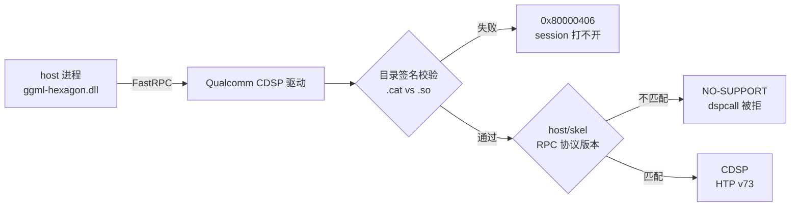

前两篇讲的是"能不能跑"：算子盘点、量化路线、实测的分工边界。到真正要把一个 11 月 20 日才发布的新架构模型塞进 NPU 时，撞上的不是算力也不是算子，而是两个和"计算"无关的东西：**签名**和**协议版本**。

这篇文章把这两道门拆开看，并回答一个更根本的问题——**这样设计合理吗。**

---

## 1. 两个报错，两次碰壁

同一台机器、同一个模型、同一个 DSP，换不同的 host 二进制，拿到两个完全不同的错误：

```text
# 用我们自己编的 skel（未签名）
ggml-hex: HTP0 failed to open session :
uri file:///libggml-htp-v73.so?htp_iface_skel_handle_invoke&_modver=1.0&_dom=cdsp&_session=0
error 0x80000406

# 用 GenieX 随包的签名 skel，但 host 是上游版本
ggml-hex: HTP0 synchronize failed : dsp-error NO-SUPPORT
ggml-hex: HTP0 dspcall : dsp-rsp NO-SUPPORT
```

第一条连 session 都没开起来，第二条 session 开了、第一个 dspcall 被拒。**这不是同一类失败。**

---

## 2. 门一：签名

### 签的是什么

DSP 侧的可执行模块是一个 **ELF 共享库**（`libggml-htp-v73.so`），旁边跟一个目录文件 `libggml-htp.cat`。

Windows 的信任体系不认识 ELF，所以签名不落在 `.so` 本身上，而是落在**目录文件**里：目录记录"这个文件的哈希是多少"，然后目录整体被签名。加载时驱动重新算 `.so` 的哈希，跟目录里的比对。

查一下这个目录的签名主体：

```text
status  : Valid
signer  : CN=Microsoft Windows Hardware Compatibility Publisher, O=Microsoft Corporation
issuer  : CN=Microsoft Windows Third Party Component CA 2014
notAfter: 2027-05-12
```

注意签名者是**微软**，不是 Qualcomm。流程是：Qualcomm 把 DSP 库提交到微软硬件开发中心做 attestation 签名，拿到目录，再随驱动/应用分发。

而直接对 `.so` 调用 `Get-AuthenticodeSignature` 会返回 `UnknownError`——"指定的信任提供程序不认识或不支持使用者的指定格式"，正好印证签名信息不在 ELF 里。

### 谁在把关

`0x80000406` 这个错误发生在 **FastRPC open session 阶段**，也就是模块被送进 DSP 之前的加载环节。结合上面的签名结构，把关的是 Qualcomm 的 CDSP 驱动：



一个关键结论：**这不是"能不能改个开关"的问题。** 我们自编的 skel 和被拒绝的 skel 是同一份源码编出来的，唯一差别就是没签名，而报错发生在 session 打开阶段而非算子执行阶段。

顺带说一句：内核驱动有 test signing 这个口子，DSP 模块没有。我们实测也没有走通——它走的是驱动自己的目录核验，不是 Windows 的驱动签名策略，而 CRD 这种设备上这条路本来是关着的。

---

## 3. 门二：协议

签名问题解决后（换成 GenieX 随包的签名 skel），session 能开，但第一个 dspcall 就返回 `NO-SUPPORT`。

原因很简单：**`ggml-hexagon.dll`（host 侧）和 `libggml-htp-v73.so`（DSP 侧）是一对必须同源编译的组件。** host 负责建图、切分算子、发 RPC；skel 负责在 DSP 上真正执行。两边的调用约定、算子编号、参数结构必须一致。

我们拿的是上游 master（含 `inkling2_loop` 支持）的 host，配的是 GenieX v0.11.0 那个 fork 编译出来的 skel，中间隔了五天左右的提交差异——协议对不上，第一个调用就挂了。

### 两道门的对照

| 组合 | 结果 | 卡在哪 |
| :--- | :--- | :--- |
| 自编 skel（未签名）+ 同源自编 host | `0x80000406` | 签名：session 都没开起来 |
| 签名 skel + 上游 host | `NO-SUPPORT` | 协议：session 开了，dspcall 被拒 |
| 签名 skel + 同源 host（GenieX 自带） | 正常 14 tok/s | 两门都过 |

第三行是正解，也解释了为什么官方版本能跑、我们改一行就废。

---

## 4. 合理吗

这是我写这篇的真正原因。分两面说。

### 安全那一面：合理，甚至必要

DSP 和 GPU 的内存模型完全不是一回事。

FastRPC 的核心是**共享物理内存 buffer**：host 分配一块内存，把句柄交给 DSP，DSP 直接读写。这意味着跑在 DSP 上的代码，能力远超一个普通用户态进程——

- 可以直接读写 host 指定的物理内存，绕过 host 侧的地址空间隔离
- 在设计上属于"可信执行环境的一部分"，能看到其它进程看不到的东西
- 一旦失控，可以在 HVCI 之外开一个持久化后门

对比 GPU：允许任意 shader，是因为 GPU 不直接 DMA 到任意物理内存，中间有 IOMMU 兜底，shader 的权限模型比 DSP 严格得多。所以在客户端设备上把 DSP 的加载权限完全放开，等于把 Secured-core 的安全基线拆了。

**从安全角度看，签名是必须的，签在微软那边也比签在厂商自己那边更容易审计。**

### 生态那一面：代价很大，而且有些代价是不必要的

问题出在它的**粒度**和**耦合方式**上。

**第一，签名粒度是"整个二进制"，不是"算子"也不是"模型"。** GPU 上你能自己写 OpenCL kernel、自己编 CUDA，出了新模型当天就能跑；NPU 上不行——只要厂商没发新 skel，新架构模型一天都跑不了。我们这次就是活例子：模型 11 月 20 日发布，上游三天内就合入了支持，但我们要等 Qualcomm 发一版新的签名 skel。

**第二，签名把"协议兼容"和"发版节奏"绑死了。** 这两件事本来应该解耦：签名保证的是"这段代码可信"，协议保证的是"A 能和 B 说话"。现在一签就把时间钉住了——skel 是 11 月 15 日的，host 是 11 月 20 日的，哪怕两边都正确、都安全，就是不能对话。

**第三，错误信息把路指向了错误的方向。** 撞门一的人看到 `0x80000406` 会去查权限、查路径、查驱动版本；撞门二的人看到 `NO-SUPPORT` 会去查算子支持表。两者都不是真正的原因，而真正的答案（"你的 host 比 skel 新五天"）没有任何地方写出来。

### 与其它平台的对比

| 平台 | 开放层级 | 新模型上线速度 |
| :--- | :--- | :--- |
| NVIDIA GPU | 二进制级（自己写 kernel） | 当天 |
| Apple ANE | 模型级（CoreML 编译器转格式） | 随 OS/编译器版本 |
| Intel / AMD NPU | 驱动 + 标准编译器栈 | 较快 |
| **Snapdragon Hexagon NPU** | **二进制级封闭** | **随厂商发版** |

Qualcomm 这套是"安全守住了，开放度给得最少"。有意思的是苹果：ANE 同样不开放 kernel，但它开放的是**模型格式**——只要模型能被 CoreML 表达，不需要苹果为你单独发一版驱动。这个折中比二进制级封闭好得多。

---

## 5. 有没有别的路

实话实说，在 Windows 客户端设备上基本没有：

| 路径 | 可行性 |
| :--- | :--- |
| 找 Qualcomm 要 dev 签名 / OEM 白名单 | 需要商务关系，个人开发者基本无门 |
| **自签 skel**（WDK Inf2Cat + 自签证书） | Windows 会接受，但 DSP 仍拒绝（见第 6 节实测），这条路在本机走不通 |
| 开 test signing | 只解决内核驱动，不解决 DSP 模块的目录核验 |
| 用 QNN 的 context binary | 同样受限于 QNN 版本，但模型侧转换自由度更大——不用等 skel 支持新算子，只要 QNN 算子集能表达这张图 |
| Linux / Android | FastRPC 在开发板上有 unsigned PD 模式，生产设备另说 |

所以对做边缘推理的人来说，结论是：**在 Windows 上，NPU 不是通用算力，是一个只接受厂商签名产物的封闭加速器。** 唯一的例外需要你自己处理证书信任链，而且下一节会看到——即使那样也不一定行。

---

## 6. 其他人做到了什么

整理这个问题时翻了 GitHub 上的同类报告，有几条比本文的发现更深入，其中一条直接修正了我的判断。

**自签 skel 是可行的。** [GenieX PR #1671](https://github.com/qualcomm/GenieX/pull/1671) 的测试计划里写着：用 WDK 的 `Inf2Cat.exe` 配合 CMake 的 `GGML_HEXAGON_HTP_CERT` 生成自签证书的 skel，在 Snapdragon X2 Elite 上跑通了 Qwen3-4B，**解码 33.2 tok/s**。也就是说 `.cat` 不一定要微软 WHQL 签，自签也能让驱动放行——前提是证书进了系统信任库。

**签名校验的粒度是"每个可加载段"。** [qualcomm-iris-vaapi#15](https://github.com/phxinyang/qualcomm-iris-vaapi/pull/15) 在 Linux / SM8550 上做了对照实验：ELF 文件偏移 `0x1000` 处有一个 `0x19e8` 字节的 Qualcomm 哈希签名块（QDSR Sub-CA 1，SHA-256 摘要，SW_ID/HW_ID/OEM_ID）；在 RX 段里翻转一个字节就返回 `0x80000406`，在段间空隙翻转则不影响加载。

**这个错误跨平台。** [GenieX#1507](https://github.com/qualcomm/GenieX/issues/1507) 在 Android（SM8650，Galaxy S24 Ultra）上复现了同一个 `0x80000406`。

**我们遇到的 26B 问题也是已知 issue。** [GenieX#1690](https://github.com/qualcomm/GenieX/issues/1690) 和 [#1691](https://github.com/qualcomm/GenieX/issues/1691) 记录了 24B dense 模型的 `host buffer exceeds max_vmem`、`hybrid` 永不完成、崩溃后必须重启才能重开 HTP session——和第二节里 gemma-26B 的症状一致。

**还有一层：HTP 队列本身也会出错。** [llama.cpp#26123](https://github.com/ggml-org/llama.cpp/issues/26123) 报告 `dspqueue_read failed: 0x2e`，4B 以上在 8 Gen 2 上可复现，1B 正常。

这几条合起来，似乎可以把"签名不可绕过"改写成：**官方分发用微软 WHQL 签名，但开发场景可以自签**。所以我们照着走了一遍。

---

### 补充：我们自己试了自签，没通过

按 PR #1671 的线索，在本机完整走了一遍自签流程：

| 步骤 | 结果 |
| :--- | :--- |
| 安装 WDK，取得 `Inf2Cat.exe` | ✅ |
| 生成自签代码签名证书（CurrentUser） | ✅ 指纹 `531187FD…` |
| `Inf2Cat /driver:… /os:10_25H2_ARM64` 生成 catalog | ✅ 无错误无警告 |
| `signtool sign /fd sha256 /f cert.pfx` 签名 catalog | ✅ `Signer: CN=Tinnci HTP Test Signing` |
| 把证书导入**本地计算机**的「受信任的根」+「受信任的发布者」 | ✅ |
| `Get-AuthenticodeSignature` 校验 catalog | ✅ `Valid` |
| 加载模型 | ❌ **仍然 `0x80000406`** |

证书链、目录签名、信任库三项全部到位，驱动依然拒绝。

这说明 **Windows 目录签名只是第一层，DSP 侧还有第二层校验**——很可能是 iris-vaapi#15 提到的 ELF 内嵌 Qualcomm 签名块（QDSR Sub-CA、SHA-256、SW_ID/HW_ID/OEM_ID）。目录签名解决的是"这个文件是我打的包"，而 DSP 要验的是"这段代码是 Qualcomm 认可的"。后者需要 Qualcomm 的签名工具链，对应 GenieX PR #1563 里提到的 `to-sign zip` 流程——先导出待签包，由 Qualcomm 签完再下发。

所以结论要再修一次，这次是往回收：

> **自签能让 Windows 接受这个文件，但无法让 DSP 接受这段代码。** 两道校验里，第一道可以自己解决，第二道不行。

这个负面结果本身有价值：它把"要不要继续折腾证书"这个问题彻底关掉了，剩下唯一的路径仍然是等 Qualcomm 的签名产物。

---

## 7. 怎么判断自己撞了哪道门

给后来者一张速查表：

| 现象 | 大概是哪道门 | 怎么验证 |
| :--- | :--- | :--- |
| `error 0x80000406` / open session 失败 | 签名 | 用官方随包的 `.so` + `.cat` 替换试试 |
| session 能开，但 `NO-SUPPORT` / `dsp-error` | 协议 | 检查 host 的 `version` 与 skel 是否同一提交 |
| 加载成功，算子在 CPU 上跑 | 算子不支持 | 看 OPTRACE 的落点 |
| 分配失败 / 显存超限 | 内存或图太大 | 降 `-c`、降 `-ngl` |

---

## 8. 长期变量：编译器在开放，信任根没有

写完前面几节，现实生活中又有两件事值得记下来——它们不改变今天的结论，但决定了三年后这个问题还在不在。

### hexagon-mlir：第一份开源的 Hexagon 编译器

[`qualcomm/hexagon-mlir`](https://github.com/qualcomm/hexagon-mlir)（BSD-3-Clause，2025 年 12 月创建）是一个基于 MLIR 的编译栈，能把 **Triton kernel** 和 **PyTorch 模型**编译到 Hexagon NPU：

| 项目 | 内容 |
| :--- | :--- |
| 支持架构 | v73 / v75 / v79 / v81（v81 的 HexKL 暂不可用） |
| 系统要求 | **Ubuntu 22.04 + root** |
| 覆盖单元 | HVX 向量、**HMX 矩阵**、TCM、DMA |
| 定位 | README 原话："complements our commercial toolchains by exploring an open-source MLIR-based compilation stack" |

它踩到了我们前面反复提到的那个东西——HMX。也就是说，**这是第一条"自己写算子就能上 Hexagon"的公开路径**，前提是你在 Linux 上。

但它同时暴露了边界的形状：这是一个"探索路线"，不是生产方案；Windows 完全不在支持列表里。

### Modular 收购：请来了 LLVM 的作者

| 时间 | 事件 |
| :--- | :--- |
| 2026-06-24 | Qualcomm 宣布收购 Modular |
| 2026-07-29 | 完成交割 |
| — | Chris Lattner 出任 EVP of Advanced AI Software and Platforms |

官方公告的措辞是 "a **heterogeneous ecosystem open to all hardware makers**"。Modular 的 MAX 本来就是多厂商运行时（2025 年就和 AMD 合作过），而 Lattner 是 LLVM、Swift、MLIR 的缔造者。

两条线合起来的逻辑很清楚：

```
hexagon-mlir  →  开源编译器（MLIR + Triton） → 新算子/新架构可以自己编译
Modular / MAX →  可移植运行时（多厂商）      → 编译结果能跑在多种硬件上
```

如果合并，终局是：你写一个 Triton kernel，编译后直接跑在 Hexagon NPU 上，**不需要等厂商为你的模型发一版运行时**。这正是本文一路最缺的东西。

### 三道现实约束

**一、编译器只支持 Linux。** 想在 Windows 上用，需要 WSL + FastRPC 直通，而 Windows 的 CDSP 驱动是否允许 WSL 内的 FastRPC 加载未签名 skel，是另一道门。

**二、编译器解决不了签名。** 签名验的是"这段代码是不是 Qualcomm 认可的"，不是"这段代码怎么编出来的"。就算 hexagon-mlir 明天支持 Windows，它产出的 skel 依然要过 `0x80000406`。

**三、MAX 还没有 Qualcomm backend。** 要接 NPU 就得走 QNN，而 QNN 恰恰是封闭的那一层。

### 三个值得盯的信号

比读新闻有用的观察点：

1. `hexagon-mlir` 是否出现 Windows / WSL 的构建说明
2. MAX 的 backend 列表里是否出现 `qualcomm` 或 `hexagon`
3. GenieX 的 `to-sign` 流程是否对开发者开放（哪怕是 dev 证书）

### 时间尺度

| 时间 | 可能发生 | 对本文结论的影响 |
| :--- | :--- | :--- |
| 3-6 月 | hexagon-mlir 继续在 Linux 迭代，Windows 无支持 | 无变化 |
| 6-18 月 | MAX 增加 Qualcomm backend（经 QNN） | 新模型支持加快，签名墙仍在 |
| 18 月+ | 若推动开放信任根或 QNN 开源 | 才是真正的解锁 |

**一句话：Qualcomm 请来了 LLVM 的作者、开源了 MLIR 编译器、买下了以"不锁定硬件"为使命的公司——这说明软件确实是他们的短板。但信任根属于安全架构，不是软件工程，编译器再好也绕不过去。**

---

## 9. 写在最后

这次移植最后没跑通，但结论比"跑通"更有价值：

**NPU 的封闭性不是工程问题，是平台设计问题。** 它决定了：新模型架构的支持速度不取决于开源社区，而取决于厂商的发版节奏；决定了你不能像调 GPU 那样调 NPU；也决定了"NPU 上跑最新模型"这件事在 Windows 上短期不会有解。

如果这件事对你有产品意义，我建议做两件事，而不是继续修移植：

1. 把这个问题提给 Qualcomm / GenieX：**signed skel 应该和上游 llama.cpp 版本解耦**。它不只影响 Inkling，任何新架构模型都会撞同一堵墙。
2. 认真评估 QNN 的 context binary 路线。它同样受版本限制，但模型侧的自由度更大，是当前更现实的备选。

至于 Inkling 2 Mini 本身，CPU 路径是通的——9.14 GB 的 Q2 量化，prompt 4.5 tok/s、生成 2.5 tok/s。等 skel 更新那天，我们那七个上游提交的移植方案还留着，可以直接拿来对照。
