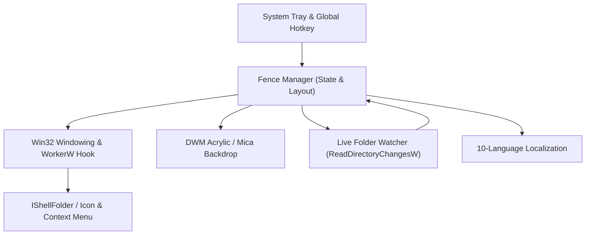
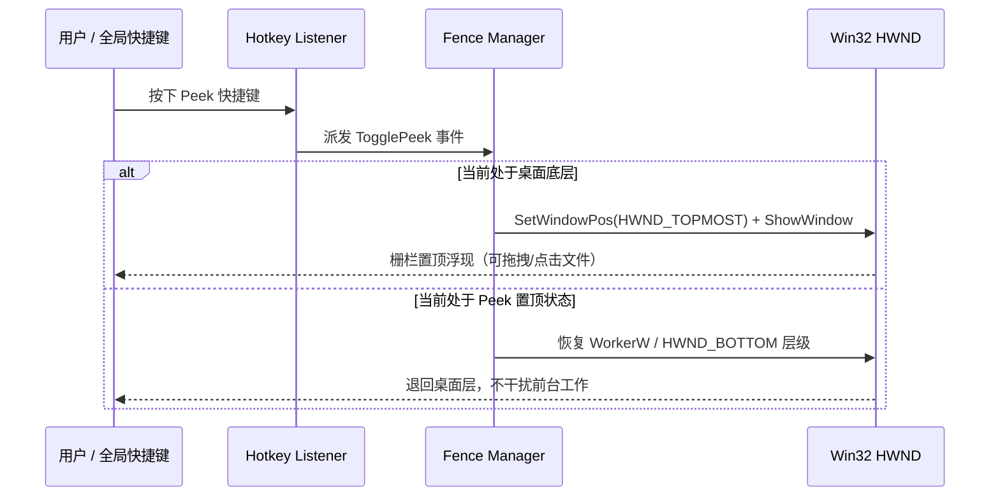

[PecoFence](https://github.com/Tinnci/PecoFence) 是我在 Windows 11 上用 **Rust** 编写的开源桌面整理工具（Stardock Fences 替代品），支持毛玻璃栅栏、实时文件夹映射、多标签页与 Peek 呼出。

这篇文章用几张结构图梳理它的核心模块与消息流。

---

## 1. 整体模块架构

---

## 2. Peek 呼出与桌面层挂载流程

为了让栅栏窗口既能贴附在桌面壁纸之上、又不遮挡普通应用窗口，同时在快捷键触发时瞬间浮现（Peek），消息流转如下：

---

## 3. 设计取舍

- **零安装便携**：配置与布局状态序列化为本地 JSON，单文件即可随身携带。
- **原生 Win32 + Rust**：避免嵌入重型 WebView 带来的常驻内存开销，保持后台静默占用极低。
- **跨文章关联**：可以在站点的 **Knowledge Graph** 页面中查看它与其他 Rust / Windows 11 文章和项目的关联。
