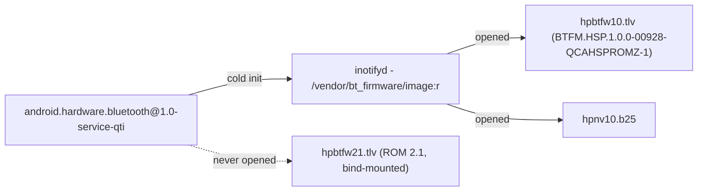

在把一台 **Redmi K40 Pro (`M2012K11C`, `haydn`, Snapdragon 888 / `SM8350`)** 刷上 **Android 16 (SDK 36, Build `BP2A.250605.031.A3`) + Magisk 30.6 (`30600`)** 后，系统属性里赫然列着全套蓝牙 LE Audio（BAP / CSIP / LC3 / Auracast）开关。这自然引出一个问题：**这颗 Qualcomm FastConnect 6900 无线芯片当前的固件到底支不支持 LE Audio？如果换用上游 `linux-firmware` 的新版蓝牙固件，能不能把 LE Audio 跑起来？**

本文完整记录了从硬件固件盘点、临时 `bind-mount` 热加载实验到用 `inotifyd` 锁定最终硬件边界的全过程。

---

## 1. 无线子系统盘点：FastConnect 6900 与当前固件版本

通过 `dumpsys wifi`、`cat /sys/class/net/wlan0/device/uevent`、`dmesg` 以及 `dumpsys bluetooth_manager`，可以完整读取这台机器的无线硬件与固件状态：

| 组件 | 实测信息 |
|---|---|
| 无线芯片平台 | Qualcomm **FastConnect 6900**（`QCA6490` / `WCN6856`，`PCI_ID=17CB:1103`，BT SoC `hastings`，manufacturer ID `29`） |
| Wi-Fi (`wlan0`) 驱动 | Host SW `2.0.8.24D` (`cnss_pci` / `qca6490`) |
| Wi-Fi (`wlan0`) 固件 | `1.1.0.3.260.1`（`HW_VERSION=400c0110`） |
| 蓝牙 HCI / LMP 版本 | Bluetooth `5.2` (`V_5_2`, `0x0b`) |
| 蓝牙 `lmp_subversion` | `0x4229` |
| 蓝牙固件分区 | `/dev/block/sde6` 挂载于 `/vendor/bt_firmware`（`vfat`, `ro`, `u:object_r:bt_firmware_file:s0`） |

进一步查看 `/vendor/bt_firmware/image/` 中的 `.tlv` 蓝牙 RAM patch 文件，发现分区里同时存放了两代固件：
- **`hpbtfw10.tlv`**（`196,660 B`）：`BTFM.HSP.1.0.0-00928-QCAHSPROMZ-1.28300.2`
- **`hpbtfw21.tlv`**（`82,648 B`）：`Patch Release PF=QCA6490ROM= 0201 BUILD=BTFW.HSP.2.1.0-00169-PATCHZ-1`

---

## 2. 系统开关 vs. 控制器真相：OS 假象与 ISO 零缓冲

只看 Android 16 的系统属性与特征列表，很容易误以为 LE Audio 已经就绪：

```text
[bluetooth.profile.bap.unicast.client.enabled]: [true]
[bluetooth.profile.bap.broadcast.source.enabled]: [true]
[bluetooth.profile.bap.broadcast.assist.enabled]: [true]
[bluetooth.profile.csip.set_coordinator.enabled]: [true]
[bluetooth.profile.vcp.controller.enabled]: [true]
[bluetooth.profile.mcp.server.enabled]: [true]
[bluetooth.profile.hap.client.enabled]: [true]
[persist.bluetooth.a2dp_offload.cap]: [sbc-aac-aptx-aptxhd-ldac-lc3-lhdc]
[persist.bluetooth.leaudio_offload.disabled]: [false]
```

包括 MIUI/Xiaomi 侧的 `LeAudioSwitchCached` 也全部显示开启（`miui_qcom_adv_audio_unicast: true`、`miui_qcom_adv_audio_bca: true`、`miui_qcom_adv_audio_bcs: true`、`miui_qcom_disableLeAudio: false`）。

但把视角切到 `dumpsys bluetooth_manager` 的 **`LeAudio Manager`** 与 **`HCI Controller Dumpsys`**，结果却是截然相反的硬拒绝：

```text
LeAudio Manager:
  Not initialized
  ...
   ISO Manager:
    Available credits: 0
    Controller buffer size: 0
    CISes:
    BISes:

HCI Controller Dumpsys:
    local_version_information:
        hci_version: V_5_2(0x0b)
        lmp_version: V_5_2(0x0b)
        lmp_subversion: 0x4229
        manufacturer_name: 29
    le_buffer_size:
        le_acl_data_packet_length: 251
        total_num_le_acl_data_packets: 16
        iso_data_packet_length: 0
        total_num_iso_data_packets: 0
    le_local_supported_features:
        page0: 0x000000000b00f9ff
```

关键指标全部指向**控制器硬件/固件未开启 ISO**：
- `iso_data_packet_length: 0`、`total_num_iso_data_packets: 0`、`ISO Manager` 缓冲大小为 `0`；
- `le_local_supported_features` 为 `0x000000000b00f9ff`，其中蓝牙核心规范定义 **CIS (Central / Peripheral)** 与 **BIS (Broadcaster / Receiver)** 对应的 bits 28–32 **全部为 `0`**；
- 因为控制器不返回 ISO 能力，Android 蓝牙栈的 `LeAudio Manager` 直接保持 `Not initialized`。

---

## 3. 实验：临时加载上游 `linux-firmware` 新版 `hpbtfw21.tlv`

在上游 `linux-firmware` 仓库（`git.kernel.org/pub/scm/linux/kernel/git/firmware/linux-firmware.git/plain/qca/hpbtfw21.tlv`）中，存在一个明显更新的 FastConnect 6900 固件构建：

- **上游 `hpbtfw21.tlv`**（`163,332 B`，SHA-256 `f37c756f3000c38ff740e4f3f80947e38344b4668bcd780411e395d1ff35596e`）
- **版本标识**：`Patch Release PF=QCA6490ROM= 0201 BUILD=BTFW.HSP.2.1.0-00680-VER_PATCHZ-1`
- 用 `strings` 扫描该二进制文件，可以明确看到完整的 **LE Audio / ISO / CIS / BIS** 协议栈字符串（例如 `LE_ISO_prepareSduBufQ`、`ISO: Tx CISReq`、`CIS-M`、`CIS-TX`、`CIS-RX`），而设备自带的 `hpbtfw10.tlv` 并不具备这些 `LE_ISO` / `CIS` 实现。

为了在不直接改写 `/dev/block/sde6` 分区、保证重启即自动还原的前提下做安全实测，我们在真机上采用了**临时 `bind-mount` + 权限/SELinux 上下文对齐**方案：

```sh
chown 1002:3002 /data/local/tmp/hpbtfw21.tlv
chmod 0440 /data/local/tmp/hpbtfw21.tlv
chcon u:object_r:bt_firmware_file:s0 /data/local/tmp/hpbtfw21.tlv
mount --bind /data/local/tmp/hpbtfw21.tlv /vendor/bt_firmware/image/hpbtfw21.tlv
```

### 踩坑一：`persist.vendor.service.bdroid.soc.alwayson = true`

第一次执行 `cmd bluetooth_manager disable` → `mount --bind` → `cmd bluetooth_manager enable` 后，蓝牙正常开启，但 `lmp_subversion` 依然是 `0x4229`。

检查系统属性后很快发现了原因：

```text
[persist.vendor.service.bdroid.soc.alwayson]: [true]
```

在高通 Android BT HAL (`android.hardware.bluetooth@1.0-service-qti`) 中，`IsSocAlwaysOnEnabled()` 为 `true` 时，普通关闭蓝牙并不会让蓝牙芯片下电复位，也不会重新执行 `PatchDLManager` 下发 `.tlv` 固件——芯片会一直沿用开机阶段已经驻留在 RAM 里的旧固件。

### 强制冷重启 HAL：结果依然 `0x4229`

于是改为强制冷重启 HAL：

1. `cmd bluetooth_manager disable`
2. 临时设置 `setprop persist.vendor.service.bdroid.soc.alwayson false`
3. `stop vendor.bluetooth-1-0-qti` → `start vendor.bluetooth-1-0-qti`
4. `cmd bluetooth_manager enable`

重启后确认新 HAL 进程（`PID 9542`）的 `/proc/9542/mountinfo` **确实能看到挂载后的 `163,332 B` `hpbtfw21.tlv`**，蓝牙也顺利恢复 `State: ON`。然而检查 `dumpsys bluetooth_manager` 与新生成的 `btsnoop_hci_261123_082653.log` 捕获的 `HCI_Read_Local_Version_Information` / `HCI_LE_Read_Local_Supported_Features` 响应，返回值仍然一模一样：
- `lmp_subversion: 0x4229`
- `le_local_supported_features: 0x000000000b00f9ff`
- `iso_data_packet_length: 0`

---

## 4. `inotifyd` 一锤定音：硬件只加载 `hpbtfw10.tlv` (`ROM 1.0`)

为什么 HAL 进程明明看到了新的 `hpbtfw21.tlv`，控制器状态却纹丝不动？由于 user 版本构建抑制了 `PatchDLManager` 的调试日志，我们直接用系统自带的 Toybox `inotifyd` 在冷重启 `vendor.bluetooth-1-0-qti` 的瞬间监控 `/vendor/bt_firmware/image` 目录的 `open` 事件（`:r`）：



实际抓到的日志只有两行：

```text
r	/vendor/bt_firmware/image	hpbtfw10.tlv
r	/vendor/bt_firmware/image	hpnv10.b25
```

谜底彻底揭晓：
1. **虽然 `/vendor/bt_firmware/image/` 同时打包了 `hpbtfw10.tlv` 和 `hpbtfw21.tlv`，但这台 Redmi K40 Pro (`haydn`) 搭载的是早期 Hastings Prime `ROM 1.0` (`QCAHSPROMZ-1`) 掩膜芯片**。
2. HAL 根据芯片回报的 SoC/ROM 版本，只会打开并下发 **`hpbtfw10.tlv`**（`BTFM.HSP.1.0.0-00928-QCAHSPROMZ-1.28300.2`）和 **`hpnv10.b25`**，根本不会读取 `ROM 2.1` 对应的 `hpbtfw21.tlv`。
3. Qualcomm 蓝牙 RAM patch 必须与芯片固化的 ROM 掩膜版本严格一致，`ROM 2.1` 固件无法运行在 `ROM 1.0` 硬件上；同时上游 `linux-firmware` 仅维护较新的 `qca/hpbtfw21.tlv`，并不提供 `qca/hpbtfw10.tlv`（请求返回 `404`）。

验证完成后，已卸载 `/vendor/bt_firmware/image/hpbtfw21.tlv` 的临时挂载、清理暂存文件并恢复 `persist.vendor.service.bdroid.soc.alwayson=true`，蓝牙保持 `State: ON` 运行于原厂固件状态。

---

## 总结

- **判断 Android 设备是否真正支持 LE Audio，不要只看系统属性或设置页开关**，一定要看 `dumpsys bluetooth_manager` 里 `HCI Controller Dumpsys` 的 `iso_data_packet_length`、`total_num_iso_data_packets` 以及 `le_local_supported_features` 中的 CIS/BIS 特性位。
- 对于使用高通无线方案的设备，`/vendor/bt_firmware/image/` 里往往同时存放多代 ROM 的固件包；修改或测试固件前，用 `inotifyd`（或内核/HAL 日志）确认实际被读取的 `.tlv` 与 NVM 文件名，比单纯替换目录里的最新文件名可靠得多。
- 在 **Redmi K40 Pro (`haydn`)** 上，受限于 **FastConnect 6900 `ROM 1.0` (`QCAHSPROMZ-1`)** 硬件及配套 `hpbtfw10.tlv` 固件不支持 Isochronous Channels (`CIS`/`BIS`)，无法通过 Android 16 ROM 开关或替换上游 `hpbtfw21.tlv` 固件来开启标准蓝牙 LE Audio。
